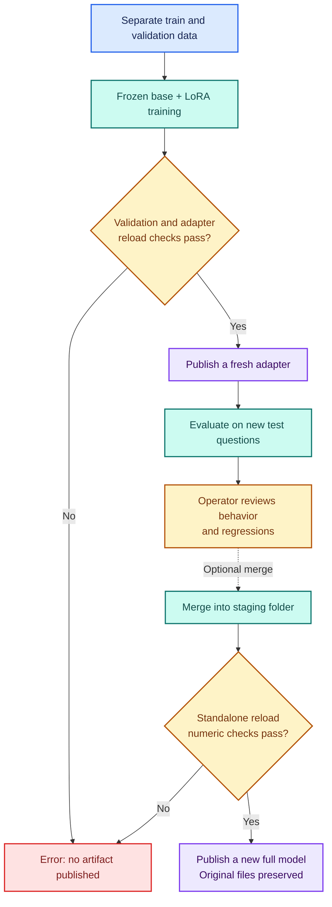

# Learn a lasting model change

**ELI5:** temporary steering adds a live nudge. LoRA learns a small patch. A merge
builds that learned patch into a **new model copy** that works without the adapter
or steering hooks. The original model files are preserved.

[Install](#install) · [Data](#prepare-three-separate-datasets) ·
[Train](#1-train-and-save-an-adapter) · [Compare](#2-evaluate-on-new-questions) ·
[Use](#3-generate-with-the-adapter) · [Export](#4-export-a-standalone-model)

## What this feature does

| Artifact | How it persists | What it needs later |
| --- | --- | --- |
| Temporary native steering | Active only for one generation | The selected hooks and prompt-specific calibration |
| Saved LoRA adapter | Learned parameters in separate safetensors | The matching base model and optional PEFT runtime |
| Merged model | Learned changes saved into a fresh full checkpoint | A compatible Transformers runtime; no adapter or steering hooks |

This workflow performs supervised learning from your explicit prompt/response
examples. It does **not** directly convert a neuron coordinate, dose or
Neuronpedia SAE feature into a permanent weight edit. Learning a behavior is not
a guarantee that it generalizes, improves truthfulness or preserves every skill.

## Install

Use **Python 3.11+** for live adapter operations:

```sh
python -m pip install -e '.[training]'
```

The optional extra installs training libraries and may download Python packages.
It never downloads model or SAE weights. Use an existing complete local dense
safetensors checkpoint and tokenizer. Core commands and adapter dry-runs remain
available without PEFT; the core package still supports Python 3.10+.

Initial scope: one local device, dense floating-point Linear/Conv1D LoRA targets,
ordinary A/B LoRA, batch size one and AdamW. Quantized training/merging, embedding
adapters, shared/tied target weights, distributed training and optimizer resume
are outside this implementation. CPU GPT-2 and Llama tiny-model round trips are
tested; fitting or training a large model on your hardware requires enough memory.

## Prepare three separate datasets

Training and validation files are JSON arrays containing exactly `prompt` and
`response`. Responses should demonstrate the behavior you actually want:

```json
[
  {
    "prompt": "Explain a model weight simply.",
    "response": "A weight is a saved number learned during training."
  }
]
```

- **Training:** examples used for optimizer updates.
- **Validation:** separate prompt/response examples used for the loss gate and
  adapter reload verification. This is model-selection data.
- **Final evaluation:** new questions in the existing category/prompt format,
  optionally with `answers` and `match`. These must be separate from both earlier
  datasets; this command rejects normalized prompt overlap and duplicate tests.

Training/validation duplicate checks collapse whitespace and case. They cannot
prove semantic independence between paraphrases. Use a genuinely separate test
set and retain unrelated-skill regression tests.

The bundled `examples/adapter-*.json` files illustrate the formats; their tiny
size is not sufficient to establish useful learned behavior. Use a representative
dataset; the illustrative examples may be rejected by the validation-loss gate. Manifests store the
explicit examples and encoded tensors in the selected artifact directory.

## 1. Train and save an adapter

Run `neuron-steer inspect --model "$MODEL" --load` to see each supported layer’s
`projection_module_path`. You can use that exact path as `--target-module` to
restrict training to a particular projection. Select module names that actually
exist in your model. `down_proj` is a common
MLP output-projection name; GPT-2 commonly uses `c_proj`. Suffixes can select
multiple layers. Unknown, non-floating, quantized and tied targets fail clearly.

```sh
MODEL=/absolute/path/to/installed/model
neuron-steer adapter train --model "$MODEL" \
  --train-data examples/adapter-train.json \
  --validation-data examples/adapter-validation.json \
  --target-module down_proj --rank 8 --alpha 16 \
  --steps 100 --learning-rate 0.0001 --max-seq-length 512 \
  --output-dir results/my-adapter --timeout 3600 --dry-run
```

Remove `--dry-run` to train. Only LoRA A/B parameters are optimized; existing base
parameters are frozen. The actual generation prompt is rendered using the shared
system/template policy and tokenized once. Response tokens are encoded separately
without added special tokens, then appended with EOS if needed. Prompt labels
are `-100`, so the causal loss trains only response/EOS tokens. The exact boundary
policy and all tensor inputs are recorded; there is no silent truncation.

Every optimizer step uses one example, with deterministic seed-based reshuffling
on each pass through the training set. Gradients are clipped to norm 1.0 and
non-finite loss, gradients or adapter parameters fail. `--gradient-checkpointing`
can reduce activation memory on compatible models; it does not guarantee fit.

Validation loss is the supervised-token-weighted mean negative log likelihood.
By default, training refuses publication if it worsens versus the unadapted base.
`--max-validation-regression` explicitly allows a chosen increase in these loss
units; it does not make that regression an improvement. A freshly loaded base
plus saved adapter must also reproduce validation loss within the recorded
numeric tolerance before publication.

## 2. Evaluate on new questions

```sh
neuron-steer adapter evaluate --model "$MODEL" \
  --adapter results/my-adapter --prompts examples/adapter-test.json \
  --output-dir results/my-adapter-test --max-tokens 128 --timeout 1800
```

One loaded model generates paired unadapted and adapter-enabled responses. The
unadapted arm disables the adapter; it is not a zero-dose native steering hook.
Both arms reset the same seed and alternate execution order across questions.

`evaluation.json` records full text, actual model inputs, effective generation
settings, token budgets, reference matches and descriptive metrics. Primary
answer-key accuracy excludes pairs where either output reaches the budget,
including forced EOS at the limit. Scores count supplied answer matches, not
semantic truth. If there are no eligible labeled pairs, no accuracy is reported.

This first adapter evaluator supports one seed per invocation and fresh output
paths, without evaluation resume or bootstrap intervals. Repeat independent runs
with explicit seeds when needed. Existing native steering evaluation retains its
separate seed/dose/control-grid capabilities.

## 3. Generate with the adapter

```sh
neuron-steer adapter generate --model "$MODEL" \
  --adapter results/my-adapter \
  --prompt 'Explain an activation in one simple paragraph.' --max-tokens 128
```

Generation inherits the adapter's saved system-role, named-template and thinking
policy unless explicitly overridden. `--thinking` and `--no-thinking` select the
requested template control; they do not prove model compliance. No native steering
hooks are installed. The base directory is explicit, and its tracked files must
match the adapter's recorded SHA256 identity even if moved to another path.
Saved validation tokenization/labels must also replay exactly under the trained
prompt policy, so tokenizer/runtime/system-policy changes fail clearly.

## 4. Export a standalone model

```sh
neuron-steer adapter merge --model "$MODEL" \
  --adapter results/my-adapter --output-dir results/my-permanent-model \
  --tolerance 0.05 --timeout 1800

neuron-steer generate --model results/my-permanent-model --baseline \
  --prompt 'Explain an activation in one simple paragraph.' --max-tokens 128
```

Merge uses PEFT's `safe_merge=True`, saves model/tokenizer files into a staging
folder, releases the loaded model and reloads the result through the ordinary
local loader. On up to four saved validation examples, complete tokenization must
match and supervised answer-token log probabilities must agree within
`--tolerance` (maximum absolute difference, default 0.05, accepted range
0.000001–0.1). This is a numeric persistence check on selected examples, not an
accuracy certificate or full-logit equivalence proof.

The reloaded checkpoint must not require PEFT adapter configuration. It can then
be used by ordinary supported Transformers loading without this project's hooks.
To return to the original behavior, load the original model directory without
the adapter. The separate adapter artifact remains available after export.

Forward output format is normalized to dictionary-style ModelOutput for
compatible nested Transformers calls. Original decoding defaults are retained; use matching decoding settings
when comparing outputs. Not every architecture, quantization or downstream engine
supports every exported checkpoint.

<details>
<summary>See the training and export lifecycle</summary>



The merge command itself does not require or certify a successful behavioral
evaluation. Numeric export verification and behavioral acceptance are distinct.

</details>

## Artifact integrity and recovery

All output directories must be fresh and outside model/adapter/input paths.
Cooperative writers acquire a path lock, write into a sibling staging directory,
and publish only after checks complete. Normal failures remove staging. A hard
worker kill can leave a hidden `.partial-*` directory; it is never treated as a
complete artifact and training does not resume from it. JSON and safetensors are
used; this workflow refuses pickle/bin adapter weights.

`neuron_steer_adapter.json` records data, settings, source/runtime versions, base
asset SHA256 identity, encoded inputs/labels, losses, selected modules and adapter
asset hashes. Repeated chat templates are stored once and referenced by hash.
Adapter metadata is capped at 64 MiB before publication, matching its reader.
`neuron_steer_export.json` records lineage, exported assets and the
standalone reload check. Adapter manifests are not cryptographically signed;
these are integrity checks for cooperative local use, not an untrusted-artifact
sandbox. Existing native checkpoint/resume semantics are unchanged; the 0.5.0
source/package identity requires fresh paths for earlier native reports.

Limits: 2,048 rows per training/validation file, 200,000 combined encoded tokens,
a configured maximum of 8–2,048 tokens per example, 1–5,000 optimizer steps, ranks
1–128 and 1–16 explicit module selectors. The total CLI deadline includes data
validation, model hashing/loading, training, saving and verification. Export needs
space for a full new model. No model weights are trained automatically merely by
installing this feature.

The implementation follows the official [PEFT quicktour](https://huggingface.co/docs/peft/quicktour)
and [checkpoint/merge documentation](https://huggingface.co/docs/peft/developer_guides/checkpoint#model-storage).
