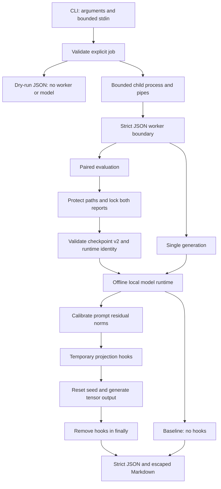

# Architecture overview

For the detailed algorithm, coordinate systems, runtime, checkpoint and transport
design, see [design.md](design.md). Version 0.2.0 adds an explicit Neuronpedia
worker route and offline research annotations; local generation/evaluation remains
separate from all network operations.

The package supports macOS/Linux. Its import path and dry-run CLI require only
Python 3.10+. Torch, Transformers and safetensors are loaded only when a live
worker constructs `LocalRuntime`.

## Responsibilities

| Module | Responsibility |
| --- | --- |
| `cli.py` | Parse public options, read explicit stdin within the command budget, dry-run, launch worker, print bounded diagnostics/results. |
| `process.py` | Concurrently drain child stdout/stderr, stream stdin, cap buffers, enforce elapsed timeout, clean the worker process group. |
| `_worker.py` | Decode a bounded private job, route execution and convert optional-runtime exceptions into JSON diagnostics. Its broad catch is intentional at this subprocess boundary. |
| `jobs.py` | Validate jobs, protect file paths, coordinate report locks, identify/validate checkpoints and run baseline/steered pairs. |
| `runtime.py` | Load local weights/tokenizer with offline configuration; apply the chat template; check context; generate; always remove hooks. |
| `steering.py` | Parse bounded targets, locate supported dense projections, calibrate residual norms and install temporary additive hooks. |
| `evaluation.py` | Read explicit prompt sets, descriptive metrics, summary calculations and Markdown serialization. |
| `storage.py` | Strict bounded JSON, unique temporary files, flush/fsync and atomic replacement per report. |

## Data and state

A generate job contains only a local model path, explicit prompt, target strings
and generation settings. An evaluation job instead names a prompt file and two
report paths. The private worker protocol is an internal implementation detail;
use the CLI or documented Python modules rather than invoking `_worker` directly.

A paired record includes the exact prompt/category, each arm's content, output
and input token counts, token-budget flag, elapsed generation time and steering
calibration when applied. Comparison metrics are computed from the two texts.
Both arms reset the same seed immediately before generation. Calibration time
is included in the steered arm's elapsed time; it is not a pure decoder benchmark.

Checkpoint v2 stores the selected prompts/settings fingerprint, resolved runtime,
ordered paired records and a recomputed summary. Completed pairs are atomic
checkpoint units. A partial pair is rerun after interruption. Missing, malformed,
duplicate, incompatible or inconsistent records fail before loading a model.
A completed compatible resume can rebuild Markdown without loading weights.

Output paths cannot name model/input files or aliases to them. Non-resume writes
reject existing JSON or Markdown. OS advisory locks cover both report paths;
they are acquired in deterministic order, non-blocking, and released on process
exit. Small hidden lock files persist to preserve their inode across competing
processes. Reports use independent atomic replacement, so recovery uses JSON as
the authoritative checkpoint if a crash leaves Markdown behind.

## Change and verification workflow

1. Install developer tools with `python -m pip install -e '.[dev]'`.
2. Add a regression reproducing a concrete failure before broadening behavior.
3. Run `python -m unittest discover -s tests -v`, `ruff check neuron_steer tests`
   and `ruff format --check neuron_steer tests`.
4. Build with `python -m pip wheel . --no-deps --no-build-isolation -w dist`.
5. Verify the installed wheel from outside the checkout. Inspect bundled prompt
   resources and exercise a dry run without runtime dependencies.
6. For runtime changes, run optional real-tensor tests in the configured model
   environment. A small explicit synthetic live smoke can validate a supported
   installed model without downloading weights or running a long evaluation.

CI runs standard-library tests, style checks, packaging and installed CLI dry-run
on Linux/macOS with Python 3.10, 3.12 and 3.13. Optional real-tensor tests skip
when torch is absent; a separate recorded local check exercises them. The CI
matrix tests supported Python/platform combinations, not every model runtime.

See [AUDIT.md](AUDIT.md) for fixed findings and remaining boundaries. In particular,
checkpoints are not signed provenance, offline loading is not an OS sandbox, and
seeded output can differ between hardware or library versions.
