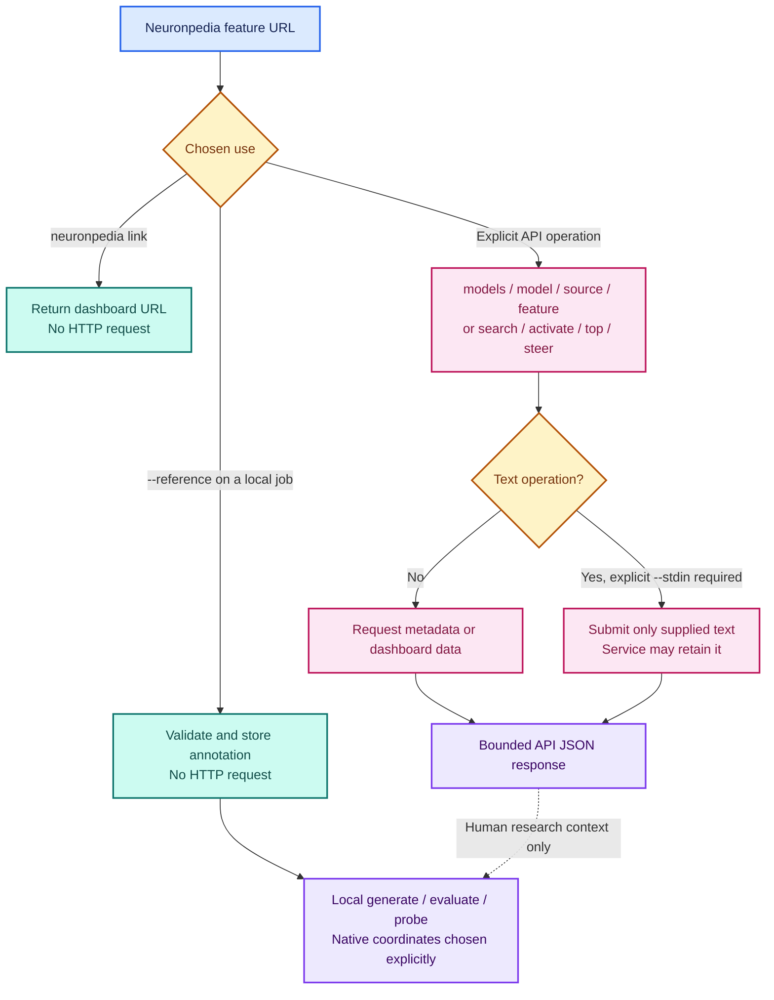
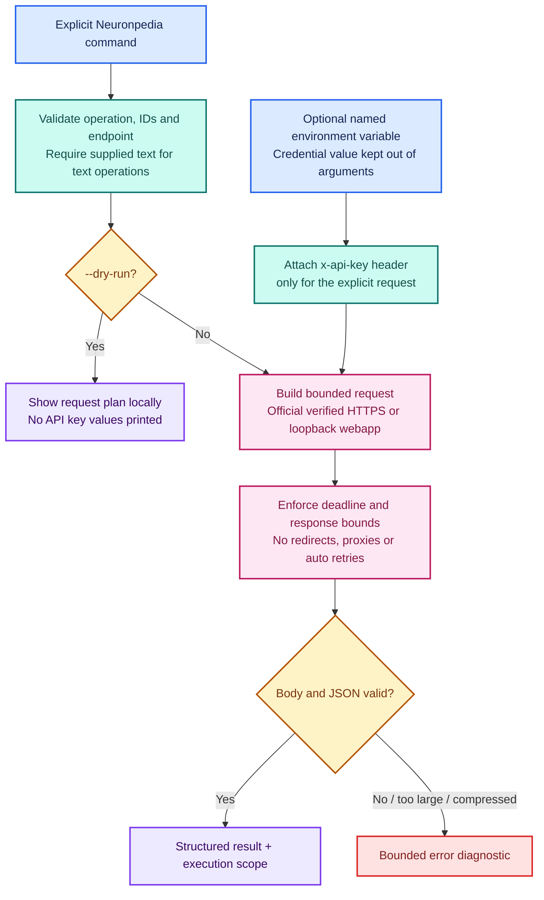

# Neuronpedia integration

Neuronpedia commands perform explicit hosted research or use a selected loopback
Neuronpedia webapp. They are separate from local Transformers hooks. No SDK,
torch installation or local weights are needed for these commands.



Solid API paths below require an explicit command; the dotted relationship is
human research context, not a coordinate conversion. See the
[visual explanation of SAE versus native coordinates](VISUAL_GUIDE.md#13-neuronpedia-and-coordinate-systems).

## Public discovery and dashboards

```sh
python -m neuron_steer neuronpedia models
python -m neuron_steer neuronpedia model --model gemma-2-2b
python -m neuron_steer neuronpedia source --model gemma-2-2b --source-set gemmascope-res-16k
python -m neuron_steer neuronpedia feature \
  --url https://www.neuronpedia.org/gemma-2-2b/20-gemmascope-res-16k/10956
python -m neuron_steer neuronpedia link --model gemma-2-2b \
  --source 20-gemmascope-res-16k --index 10956
```

`link` validates and returns a dashboard URL without contacting a server. Feature
lookup supports either an official `--url` or explicit model/source/index fields;
conflicting IDs fail. Metadata and raw API results are returned in JSON. Exact
Neuronpedia IDs are independent of Hugging Face repo names or local model paths.

## Text analysis and steering

Text operations require explicit stdin. Add `--dry-run` to inspect the planned
request without sending anything. These examples use synthetic text:

```sh
printf '%s' 'meeting proposals' | python -m neuron_steer neuronpedia search \
  --model gemma-2-2b --source 20-gemmascope-res-16k --stdin --dry-run

printf '%s' 'A synthetic test sentence.' | python -m neuron_steer neuronpedia activate \
  --url https://www.neuronpedia.org/gemma-2-2b/20-gemmascope-res-16k/10956 \
  --stdin --dry-run

printf '%s' 'A synthetic test sentence.' | python -m neuron_steer neuronpedia top \
  --model gemma-2-2b --source-set gemmascope-res-16k --limit 10 --stdin --dry-run

printf '%s' 'Write a short story.' | python -m neuron_steer neuronpedia steer \
  --model gemma-2-2b --source 20-gemmascope-res-16k --index 3124 \
  --strength 1 --max-tokens 48 --stdin --dry-run
```

Remove `--dry-run` to submit the explicit text. Availability depends on the chosen
model/source having inference enabled. `search` performs semantic explanation
search in one source and accepts `--offset`; pagination is manual. `top` accepts
an optional `--source` restriction and 1–100 results. `steer` requests one feature,
simple additive steering, signed finite strength ±1000, temperature 0–2, up to
256 output tokens and a seed in ±100000000. The API may impose stricter limits.
Default and steered outputs remain in the returned service response.

Hosted text can be logged, retained or shared by the service; steering outputs
may be saved with a share URL. Explanation search can involve upstream embedding
services. Use non-sensitive text or a correctly configured self-hosted backend.
Dry-run prints its explicit text locally but never reads or prints API-key values.
No call/message history is fetched by this independent package.

## Credentials, self-hosting and time limits




```sh
python -m neuron_steer neuronpedia models --api-key-env NEURONPEDIA_API_KEY
python -m neuron_steer neuronpedia models --endpoint http://127.0.0.1:3000
```

Set the credential in the named environment variable; only `x-api-key` carries
its value. It is never an argument value or URL field. The default endpoint is
`https://www.neuronpedia.org`; the official non-www HTTPS origin is also allowed,
but redirects are refused. Other remote/LAN hosts, URL credentials, query strings,
fragments and proxies are rejected. HTTPS verification stays enabled; `--ca-file`
selects a private CA bundle when needed.

A local endpoint targets Neuronpedia's **webapp API**, not its separate inference
server. The webapp must already contain the relevant resources and have its
inference hosts configured. This package installs/starts no Neuronpedia services
and downloads no model/SAE weights. A local gateway can still forward externally.
See the [upstream setup guide](https://github.com/hijohnnylin/neuronpedia#setting-up-your-local-environment).

`--timeout` is a total CLI budget of 1–300 seconds (default 30), including stdin
and the bounded worker. Text is limited to 10000 characters/40000 UTF-8 bytes,
request bodies to 128 KiB and responses to 8 MiB. Compressed responses, malformed
or incomplete bodies, duplicate JSON keys and non-finite JSON are rejected.
There are no automatic retries; failures never switch to a local model/provider.

## Record research without networking during local runs

```sh
python -m neuron_steer generate --model /path/to/local/model --neuron 0:0:0 \
  --prompt 'A synthetic example.' \
  --reference https://www.neuronpedia.org/gemma-2-2b/20-gemmascope-res-16k/10956 \
  --dry-run
```

`generate` and `evaluate` accept up to 16 validated references, stored in results
and evaluation reports. They are normalized/deduplicated annotations and participate
in checkpoint identity. They are never fetched and never become local neuron
coordinates or downloaded vectors. The zero-dose target above is a control.
An SAE feature coordinate requires its exact decoder/model/hook interpretation;
it cannot be used as a native MLP coordinate merely by copying its number.

The detailed derivation and execution boundaries are in [design.md](design.md).
API shapes were checked against the [official documentation](https://docs.neuronpedia.org/api-and-data/api)
and [endpoint implementation](https://github.com/hijohnnylin/neuronpedia/tree/main/apps/webapp/app/api).

## Local probe context

`neuron-steer probe` accepts repeatable `--reference FEATURE_URL` annotations.
References appear alongside candidate profiles and in experiment identity without
an HTTP request. Probe rankings describe native MLP projection coordinates; SAE
features require their own encoder/decoder and model/layer alignment. An attached
reference does not establish a mapping. Use explicit Neuronpedia operations here
for hosted research, then test native-coordinate hypotheses with local controls.
