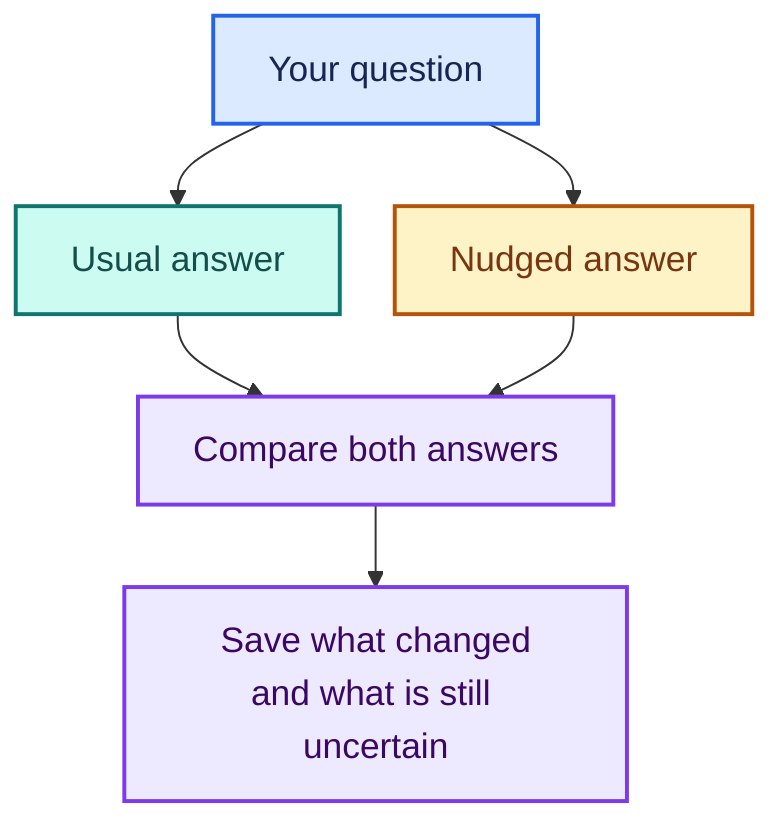
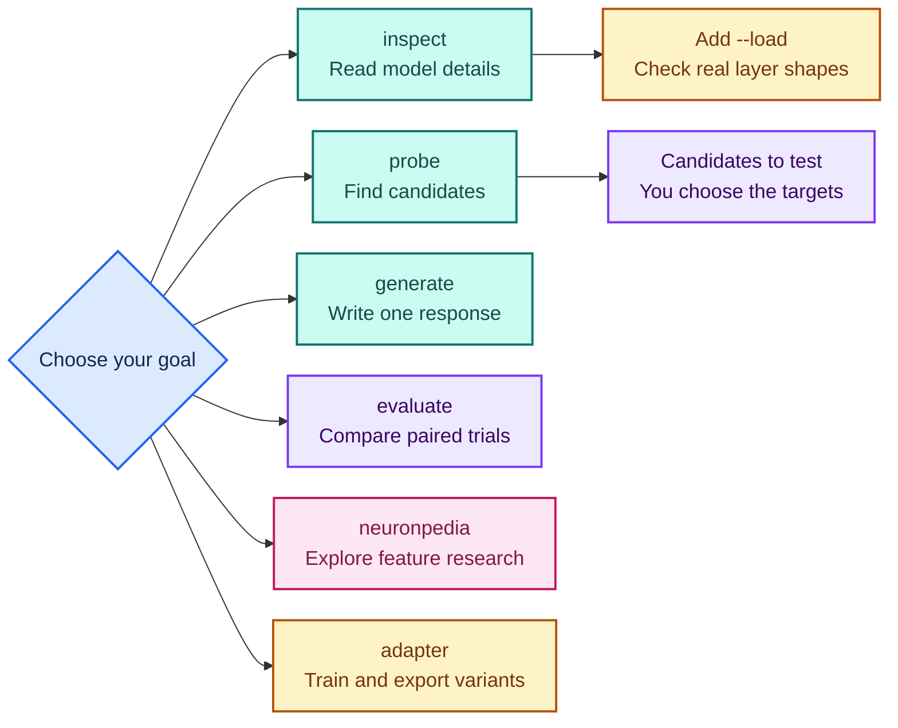
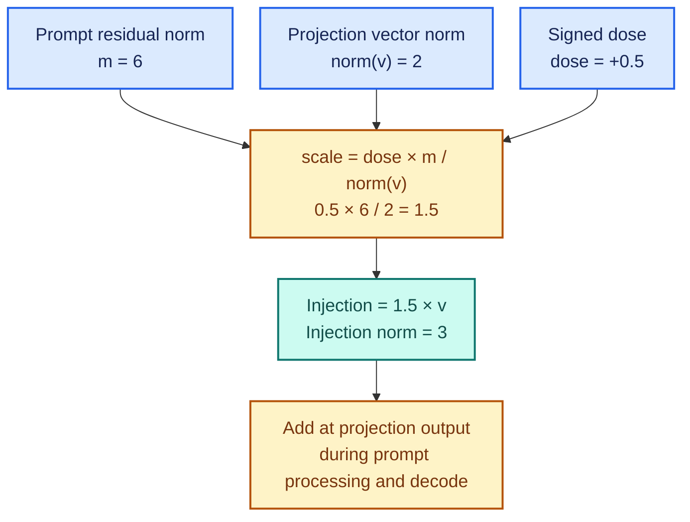

# neuron-steer

**0.5.0 · Python 3.10+ · macOS/Linux · MIT**

Explore what changes when you temporarily nudge a language model’s internal
signals. Use installed local weights to inspect the model, find candidates,
generate answers and run controlled comparisons. Add research context through
Neuronpedia. **Original model files are preserved.** A separate [LoRA workflow](ADAPTERS.md)
can learn and export lasting changes into new artifacts.

[Install](#install) · [ELI5](#eli5) · [Visual guide](VISUAL_GUIDE.md) ·
[Examples](#examples) · [Technical design](design.md)

## Start here

| Your goal | Read this |
| --- | --- |
| Install and try the CLI | [Installation](#install), then [a no-weights preview](#a-preview-an-unhooked-baseline-without-weights) |
| Understand the idea | [ELI5 below](#eli5) or the [beginner visual path](VISUAL_GUIDE.md#choose-your-reading-path) |
| Discover and test candidates | [Inspection and probing](#i-inspect-installed-weights-and-discover-candidates) |
| Learn and export a lasting change | [LoRA adapters and standalone models](ADAPTERS.md) |
| Understand the implementation | [Detailed design](design.md) |

## Install

Choose a Python **3.10+** environment first. The commands below call it `python`;
use an explicit supported interpreter if your shell selects an older version.

```sh
git clone https://github.com/djayuffe/neuron-steer.git
cd neuron-steer
python -m venv .venv
source .venv/bin/activate
python -m pip install -e .
neuron-steer --help
```

The core package uses Python's standard library. Dry-runs, offline links and the
Neuronpedia API client work without torch or local weights. To run local models:

```sh
python -m pip install -e '.[runtime]'
```

This can download Python dependencies. The application itself loads an **existing
local Transformers safetensors checkpoint and tokenizer** with offline loading
settings and remote model code disabled. It never downloads model or SAE weights.
Use runtime versions appropriate for your exact model. Ollama/GGUF/MLX checkpoints
are not directly loaded by this implementation.

## ELI5

Imagine a robot storyteller with a huge mixing desk inside it. Its ordinary
settings help it choose the next word. We can temporarily add a little extra
signal at one exact place on that desk and listen to how the story changes.

Here is the experiment:

1. Ask the storyteller a question with no extra signal. Save that answer.
2. Ask the same question while adding the chosen signal. Save that answer too.
3. Compare the answers and record exactly which setting you used.
4. Remove the extra signal when the experiment finishes.



The signal's **direction** comes from one of the model's existing projection
vectors. The **dose** controls how much signal is added. Coordinates are numeric
positions; understanding their effect requires experiments. A change might alter
word choice, style, coherence or factual reliability, and it might have little
visible effect on a particular question.

Temporary native steering lasts for the current generation and does not train
weights. The separate [adapter workflow](ADAPTERS.md) learns a saved LoRA patch
and can merge it into a fresh standalone model copy. Neuronpedia helps you explore research
about model features; its feature coordinates need their own model/SAE context.

**Three useful words:** weights are the model’s saved settings; activations are
its temporary readings for a question; steering adds a temporary signal during
a run. More terms have [short ELI5 definitions in the glossary](VISUAL_GUIDE.md#16-glossary-and-a-worked-experiment).

## Visual feature map

Choose the question you want to answer. This map is a quick reference; the table
above is the fastest way to get started. The full [visual guide](VISUAL_GUIDE.md)
walks through every command, concept and evidence boundary. Blue marks inputs,
teal local computation, amber choices, purple evidence, pink service-side research,
and red limits. Labels carry the same meaning without relying on color.

<details>
<summary>Open the visual command map</summary>



</details>

A practical path is **inspect → probe → choose explicit targets → evaluate**.
Probing proposes hypotheses; paired experiments and controls test their effects.
Neuronpedia adds research context with its own model/feature coordinate system.

## How it works

> **ELI5:** Read the question, run the model, optionally add a measured signal,
> compare the answer, and remove the temporary instructions.

<details>
<summary>Open the six-step technical walkthrough</summary>

### 1. Prepare a bounded job

The CLI validates settings, target coordinates and research references before
waiting for stdin. Prompts are explicit: either `--prompt` or `--stdin` for one
generation, or a named/bundled JSON prompt set for evaluation. No private
communication history is discovered or read.

A bounded child process runs live work. Local jobs construct `LocalRuntime`;
explicit Neuronpedia jobs construct the HTTP client instead. The CLI enforces a
total timeout and caps child stdout/stderr, then cleans up the worker process
group on timeout or cancellation.

### 2. Load and format the local model

The runtime selects the requested device, loads local weights and tokenizer,
applies the model's chat template and counts input tokens. `--device auto` prefers
CUDA, then MPS, then CPU. The input-plus-completion budget is checked against the
requested context bound and known model configuration. Model/hardware memory
limits still apply.

`generate --baseline` proceeds directly to generation without inspecting MLP
projection layouts, calibrating norms or installing hooks. An explicit
`--neuron LAYER:NEURON:DOSE` job performs the following extra steps.

### 3. Find the projection direction

A typical MLP output projection maps a wide internal representation back into
the model's residual stream. For a standard Linear projection:

```text
W has shape [residual_width, mlp_width]
v = W[:, neuron_index]
```

`v` describes the residual-space direction associated with that internal
coordinate. For GPT-2 Conv1D-style transposed storage, the implementation selects
the corresponding row instead. The selected layer, neuron and tensor orientation
are validated against the loaded model.

### 4. Calibrate the dose to the prompt

The program runs the prompt once without steering and observes the hidden output
of each selected decoder block. For the first batch element, it computes the
median residual-vector norm across prompt positions, excluding position zero when
there is more than one position. A single-position prompt uses that one position.
Use `--calibration all` to include every position; the default `skip-first` is a
positional convention and does not identify whether the first token is BOS.

For a selected projection vector `v` and signed dose `d`:

```text
m         = median prompt residual norm at the selected layer
scale     = d × m / ||v||₂
injection = scale × v
```

The injected vector's norm is approximately `abs(d) × m`. This makes the dose
relative to the prompt's observed residual magnitude. For example, if `m = 6`,
`||v||₂ = 2`, and `d = 0.5`, then `scale = 1.5` and the injection norm is `3`.
This is a mathematical normalization, not a guarantee of a particular behavior.




Scaling uses float32 before conversion to the projection dtype. Invalid norms,
non-finite scales and dtype overflow are rejected before steering hooks are used.

### 5. Add the vector during generation, then remove the hooks

A temporary forward hook adds the calibrated vector to the projection output:

```text
projection_output[..., :] += injection
```

The vector broadcasts across token positions during prompt processing and decode.
Its direction and magnitude stay fixed for that generation. Multiple targets are
calibrated from the same unsteered prompt pass and add their respective vectors.
Positive dose adds a direction; negative dose subtracts it. This operates on the
projection output rather than directly assigning a neuron's preactivation value.

The seed is reset immediately before generation, after calibration. Every steering
hook is removed in a `finally` block, including when generation fails. A zero-dose
target still performs calibration and installs a zero-vector hook; a baseline
installs no hooks. Both paths are useful controls, but have different execution
costs and are recorded separately.

### 6. Compare outputs and save reproducible records

Evaluation loads the model once and generates two responses per prompt: unhooked
baseline and selected intervention, using the same settings and seed. The default
`--order alternate` swaps their execution order on every second trial; controls
run afterward. Use `--order baseline-first` for a fixed main-arm order. It records
complete decoded text, token counts, timing, calibration and descriptive text
metrics. Seeded equality across hardware/library versions is not promised.

Checkpoint **v3** is written after every complete trial, including its controls.
Its recoverable manifest contains prompts/answer keys, system policy, source
hashes, references, runtime versions, and local asset identity. Each generation
also records rendered text, exact token IDs, template and effective decoding
configuration. Default asset identity uses file size/mtime; use
`--asset-identity sha256` for content hashes (large weights take time to hash).
Older v1/v2 reports remain historical documents and cannot resume under v3.
`--resume` requires an existing compatible checkpoint. Report paths are protected
from model/input overwrites and competing writers; each report is replaced
atomically. JSON is the recovery checkpoint if Markdown is stale after a crash.

For tensor shapes, the exact median convention, checkpoint validation and transport
details, see [design.md](design.md).


</details>

## Examples

Commands after installation can also be run as `python -m neuron_steer ...` from
the same environment. Replace `/absolute/path/to/model` with an existing local
checkpoint. Examples with `--dry-run` do not load weights or make API requests.

### A. Preview an unhooked baseline without weights

```sh
neuron-steer generate --model /absolute/path/to/model --baseline \
  --prompt 'Write one friendly greeting.' --dry-run
```

The JSON preview shows the job, empty targets, and that model dimensions were
not validated. A dry-run confirms settings; it does not prove a model fits memory.

### B. Generate a real baseline

```sh
neuron-steer generate --model /absolute/path/to/model --baseline \
  --prompt 'Write one friendly greeting.' --max-tokens 32 --seed 0
```

Use stdin for explicit text you prefer to keep out of shell arguments:

```sh
printf '%s' 'Write one friendly greeting.' | neuron-steer generate \
  --model /absolute/path/to/model --baseline --stdin --max-tokens 32
```

Selected fields from the recorded local Qwen3.5-4B baseline smoke test are shown
below. Other models/settings can produce different output and token counts.

```json
{
  "mode": "baseline",
  "content": "Hello!",
  "tokens": 5,
  "input_tokens": 39,
  "reached_token_budget": false,
  "steering": null
}
```

### C. Preview or apply an explicit intervention

```sh
neuron-steer generate --model /absolute/path/to/model --neuron 0:0:0.25 \
  --prompt 'Write one friendly greeting.' --max-tokens 32 --seed 0 --dry-run
```

`0:0:0.25` means layer 0, neuron coordinate 0, dose +0.25. It is an illustrative
coordinate, not a discovered “friendly greeting” feature. Verify the model layout
and choose a meaningful target for your experiment, then remove `--dry-run` to
execute it. Repeat `--neuron` for multiple unique targets. Use `0:0:0` for a
zero-dose control on a supported projection. `--baseline` and `--neuron` cannot
be combined.

### D. Preview and run a small paired evaluation

Run the following paired examples from the cloned repository root.
The three neutral prompts are in [examples/prompts.json](examples/prompts.json).
First validate the selected prompt count and output paths:

```sh
neuron-steer evaluate --model /absolute/path/to/model --neuron 0:0:0.25 \
  --prompts examples/prompts.json --limit 2 --max-tokens 64 --seed 0 \
  --output results/example.json --timeout 300 --dry-run
```

Remove `--dry-run` to execute the two baseline/intervention pairs:

```sh
neuron-steer evaluate --model /absolute/path/to/model --neuron 0:0:0.25 \
  --prompts examples/prompts.json --limit 2 --max-tokens 64 --seed 0 \
  --output results/example.json --timeout 300
```

Inspect `results/example.json` and `results/example.md`. Use `--limit 0` for the
whole selected prompt set. Omit `--prompts` to use the bundled 100-prompt set.
JSON prompt records have `category` and `prompt` strings; exact prompt whitespace
is preserved.

### E. Resume an interrupted evaluation

Repeat the original settings and add `--resume`:

```sh
neuron-steer evaluate --model /absolute/path/to/model --neuron 0:0:0.25 \
  --prompts examples/prompts.json --limit 2 --max-tokens 64 --seed 0 \
  --output results/example.json --timeout 300 --resume
```

Completed trials are retained; an incomplete trial is rerun with all its controls. A completed compatible
checkpoint can rebuild Markdown without loading weights. Changed settings,
references, package/runtime versions or tracked model assets require new report
paths. Missing or incompatible checkpoints fail rather than starting a fresh run.

### F. Interpret the result fields

| Field | Meaning |
| --- | --- |
| `mode` | `baseline` for unhooked generation; `steered` for explicit targets, including zero dose. |
| `content` | Newly generated text, decoded without special tokens and stripped at the edges. |
| `input_tokens` / `tokens` | Encoded input length / newly generated token count. |
| `reached_token_budget` / `possibly_truncated` | Output met the token budget, including a forced EOS at the limit. Conservatively excluded from scored complete pairs. |
| `raw_content` | Decoded output before edge stripping; used for answer-key scoring. |
| `manifest` | Exact input/token IDs, prompt policy and effective generation configuration. |
| `steering.applied` | All requested hooks actually executed; installation alone is insufficient. |
| `steering.neurons` | Per-target calibration, vector norm and scale for an intervention; baseline steering is `null`. |
| `runtime` | Loaded model path, device and runtime versions. |
| `neuronpedia_references` | Research annotations, never automatically fetched or converted into targets. |

Evaluation summaries also show changed responses, text similarity, length and
keyword counts. These describe the outputs; read the actual text before drawing
conclusions. They do not establish quality, safety, factuality or causality.

### G. Repeated seeds, dose sweeps and answer keys

ELI5: compare the same questions with the steering switch off and on. Repeat the
comparison, try several strengths, and add controls to see whether any improvement
is specific to your chosen direction. An answer key checks stated answers; it
does not prove general truthfulness.

```sh
neuron-steer evaluate --model /absolute/path/to/model --neuron 0:0:0.25 \
  --prompts examples/answer-key-prompts.json --max-tokens 64 \
  --temperature 0.7 --seeds 0,1,2 --dose-scales 0,0.5,1 \
  --control zero --control random --control reversed --control ablation \
  --asset-identity sha256 --output results/controlled.json --timeout 3600
```

This plans 27 trials (3 prompts × 3 seeds × 3 strengths). With one target,
each trial has baseline, steered, zero, random, reversed and leave-one-target-out
arms: 162 generations. Add `--dry-run` to inspect the plan without loading weights.
Choose an actual supported coordinate for your model. Seeds mainly vary sampled
outputs; repeating greedy generation does not create independent evidence.

- `zero`: same hook path with zero dose.
- `random`: deterministic random directions matched to each target's injection norm.
- `reversed`: negate every selected dose.
- `ablation`: leave out each target in turn; one target reduces to an unhooked arm.

A prompt may include `"answers": ["4"]` and `"match": "normalized"` (default)
or `"exact"`. Normalized matching collapses whitespace and casefolds; exact
matching compares the unstripped decoded text. Neither uses substring matching
or an AI judge. Budget-limited pairs are excluded from primary answer-key scores.
Reports show complete/truncated counts, scores by seed and dose, control
comparisons, and a 1,000-replicate prompt-cluster bootstrap interval when at least
two scored prompt clusters exist. Small or selected datasets can still mislead.

### H. Select prompt policy explicitly

Chat templates are rendered once, then tokenized with `add_special_tokens=False`
to prevent duplicate BOS tokens. Plain-text fallback uses tokenizer special tokens.
`--system-role auto` retries with the system instruction merged into the user
message only for recognized role-rejection errors; `strict` propagates those
errors and `merge` selects the merged form directly. `--chat-template NAME`
selects a named tokenizer template. The resolved template controls whether
`enable_thinking` is passed; reports distinguish requesting this option from
verifying that a model actually follows it.

### I. Inspect installed weights and discover candidates

ELI5: before turning a dial, look at which dials respond differently to two kinds
of questions. That gives you ideas to test. A dial lighting up does not establish
that turning it will improve the answer.

```sh
MODEL=/absolute/path/to/your/installed/model
mkdir -p results

# Configuration only: no model weights or optional runtime imported.
neuron-steer inspect --model "$MODEL"

# Load existing weights and verify each supported projection and its dimensions.
neuron-steer inspect --model "$MODEL" --load --timeout 180

# Compare two categories using unmodified prompt forwards; no text is generated.
neuron-steer probe --model "$MODEL" --layer 0 --top-k 8 \
  --prompts examples/contrast-prompts.json \
  --positive arithmetic --negative greeting \
  --positions last --max-input-tokens 512 --timeout 300 > results/probe.json
```

`inspect` reports configuration claims separately from verified loaded layouts.
It finds named templates in tokenizer configuration and external Jinja files.
`probe` observes the actual inputs to the selected MLP output projections,
including GPT-2's transposed Conv1D layout. It returns native `layer:neuron`
coordinates, signed/absolute activation means, projection norms, category means,
ranking scores, exact prompt/token/model-input manifests and research annotations.

Without category options, score = mean absolute activation × projection-vector
norm. With `--positive`/`--negative`, score = absolute difference of the categories'
signed mean activations × projection-vector norm. Each prompt has equal weight;
token positions are averaged within each prompt. Categories are labels you
supply; these scores do not assign a semantic meaning to a neuron.

`--positions last` (default) observes the last **formatted input** token, often an
assistant prefix. Use `all` or `skip-first` for other explicit selections. Repeat
`--layer` for up to eight layers. Bounds are 64 prompts, 64 candidates per layer,
and 4,096 input tokens per prompt (default 512). Oversized inputs fail without
silent truncation. Add `--dry-run` to validate the plan without loading weights.

To try the top coordinate with an exploratory dose:

```sh
TARGET=$(python -c 'import json,sys; print(json.load(open(sys.argv[1]))["layers"][0]["candidates"][0]["coordinate"] + ":0.1")' results/probe.json)
neuron-steer generate --model "$MODEL" --neuron "$TARGET" \
  --prompt 'What is 7 + 8? Reply with only the integer.' --max-tokens 64
```

The dose above is an example, not a calibrated behavioral recommendation. Use
`evaluate` with separate validation prompts, repeated seeds, dose scales and
zero/random/reversed/ablation controls before selecting an intervention. Keep the
same installed model and inspect the probe's manifest. Candidate ranking is
observational, includes prompt/template effects, and omits bias contributions,
interactions and downstream causal effects. Reusing discovery prompts as a final
benchmark can overstate results.

Add `--reference FEATURE_URL` to a probe to preserve Neuronpedia context without
fetching or submitting text. Native neuron coordinates remain distinct from SAE
feature coordinates; there is no automatic conversion between them.

## Lasting learned changes

> **ELI5:** steering is a temporary nudge; a LoRA adapter is a learned patch;
> merging saves that patch into a new full model. The original files remain intact.

Use **Python 3.11+** and `python -m pip install -e '.[training]'`. The new commands
are `adapter train`, `adapter evaluate`, `adapter generate` and `adapter merge`.
They require explicit local data and write only fresh artifacts. Training does
not automatically turn a neuron/SAE coordinate into a permanent edit.

See [the complete adapter guide](ADAPTERS.md) for data formats, loss gates,
independent evaluation, export verification and copy/paste commands.

## Neuronpedia

Explore public model/source metadata or a feature dashboard:

```sh
neuron-steer neuronpedia models
neuron-steer neuronpedia feature \
  --url https://www.neuronpedia.org/gemma-2-2b/20-gemmascope-res-16k/10956
```

Preview explanation search using explicit text:

```sh
printf '%s' 'meeting proposals' | neuron-steer neuronpedia search \
  --model gemma-2-2b --source 20-gemmascope-res-16k --stdin --dry-run
```

Removing `--dry-run` submits that text to the selected service, where it may be
retained. The client also supports activation tests, top-feature inference,
service-side steering and offline links. See [NEURONPEDIA.md](NEURONPEDIA.md) for
credentials, self-hosting and full examples.

To annotate a local experiment without contacting Neuronpedia:

```sh
neuron-steer generate --model /absolute/path/to/model --baseline \
  --prompt 'A synthetic example.' \
  --reference https://www.neuronpedia.org/gemma-2-2b/20-gemmascope-res-16k/10956 \
  --dry-run
```

| Coordinate or reference | Scope |
| --- | --- |
| Local `LAYER:NEURON:DOSE` | An explicit native MLP projection coordinate in the loaded local model. |
| Neuronpedia `MODEL/SOURCE/INDEX` | A feature or vector interpreted within that model/source/hook configuration. |
| Local `--reference URL` | A stored research annotation; no network request, weight download or target mapping. |

An SAE feature would require its exact decoder, base model, hook and normalization
to reproduce locally. A dashboard URL alone does not provide that adapter.

## Limits

The CLI supports macOS/Linux and compatible local Transformers causal models.
Steering requires a supported dense projection layout; baseline generation avoids
that extra layout requirement. Hardware, memory and runtime versions constrain
which checkpoints can load. Offline loading flags are library configuration,
not an OS network sandbox. Generated models have no actions or tools in this app.

Common options are `--device`, `--max-tokens`, `--temperature`, `--seed`,
`--context-size`, `--thinking`, and the total-command `--timeout`. The CLI help and
[design.md](design.md) document bounds and exact behavior. Larger dose or longer
output is not guaranteed to produce a better or more meaningful intervention.

| Problem | Check |
| --- | --- |
| Command not found | Activate the environment used for installation, or use `python -m neuron_steer`. |
| Python version rejected | Select Python 3.10+; do not bypass the package requirement. |
| Model files missing | Point to a complete existing local checkpoint/tokenizer. No automatic model download occurs. |
| Unsupported projection | Check the model's architecture; `--baseline` can run without projection hooks if the loader supports the model. |
| Report already exists | Resume a compatible evaluation or choose new report paths. |
| Resume settings differ | Preserve the original inputs/settings/environment or start a fresh report. |
| Output ends early | Inspect `reached_token_budget`, EOS behavior and the model's context/output settings. |
| API request fails | Check exact Neuronpedia IDs, inference availability, credentials and HTTP diagnostics. |

## Documentation and verification

| Document | Purpose |
| --- | --- |
| [ADAPTERS.md](ADAPTERS.md) | Local supervised LoRA training, held-out comparison and verified standalone export. |
| [VISUAL_GUIDE.md](VISUAL_GUIDE.md) | Colorful diagrams, ELI5 explanations, command map, glossary and a worked research workflow. |
| [design.md](design.md) | Detailed algorithm, tensor shapes, local/API data flow and checkpoint semantics. |
| [NEURONPEDIA.md](NEURONPEDIA.md) | API workflow, self-hosting and transport boundaries. |
| [ARCHITECTURE.md](ARCHITECTURE.md) | Module map, development checks and packaging. |
| [AUDIT.md](AUDIT.md) | Concrete fixes, evidence and remaining limits. |
| [CHANGELOG.md](CHANGELOG.md) | Release and compatibility history. |
| [verification/README.md](verification/README.md) | Standalone checks versus historical experiment provenance. |

Extracted from CallAI's steering experiments as an independent MIT-licensed
package. Original attribution and historical artifacts are retained. See the
verification records for the exact models, controls and environments tested;
universal model compatibility or bug-free operation is not claimed.
