# Understand neuron-steer

**Explore a model. Try a temporary nudge. Compare what changes.**

This guide starts with everyday explanations. Each topic follows the same order:
**ELI5 → picture → key point → optional technical details**. You can read the
short version first and open the details when you need them.

[Install and try it](README.md#install) · [Runnable examples](README.md#examples) ·
[Glossary](#16-glossary-and-a-worked-experiment) · [Technical design](design.md)

## Choose your reading path

| If you want to… | Start here |
| --- | --- |
| Understand the idea in a few minutes | [The basic idea](#1-the-basic-idea) → [Choose a command](#2-choose-a-command) → [The workflow](#3-the-complete-research-workflow) |
| Understand what happens inside the model | [Text inputs](#4-from-text-to-model-inputs) → [Coordinates](#5-what-a-neuron-coordinate-means) → [Dose](#6-dose-and-calibration) → [Hooks](#7-temporary-hook-lifetime) |
| Plan a useful experiment | [Probing](#8-how-probing-finds-candidates) → [Controls](#9-seeds-dose-sweeps-and-controls) → [Scoring](#10-what-the-scores-establish) |
| Understand saved results and integrations | [Manifests](#11-manifests-and-reproducibility) → [Resume](#12-saving-and-resuming-experiments) → [Neuronpedia](#13-neuronpedia-and-coordinate-systems) |

Show the color key and all topics

### How to read the colors

| Color | Meaning | Typical example |
| --- | --- | --- |
| Blue | Inputs or a question | An explicit prompt or installed checkpoint |
| Teal | Local computation | Tokenization, probing, generation |
| Amber | An experiment choice or intervention | A dose, branch or selected target |
| Purple | Results and recorded evidence | Manifests, scores, candidate profiles |
| Pink | Explicit service-side research | Neuronpedia API operations |
| Red | A limit, exclusion or failure | Context overflow or incompatible resume |

Node labels and arrow captions carry the meaning as well as color. Diamonds are
decisions; rectangles are actions or records. Solid arrows show data/control flow;
dotted arrows show a research relationship or an operator's next iteration.
Each diagram has an accessible title and description. If your Markdown viewer
shows source code, use this document on GitHub or a Mermaid-enabled preview.

### Find the concept you need

1. [The basic idea](#1-the-basic-idea)
2. [Choose a command](#2-choose-a-command)
3. [The complete research workflow](#3-the-complete-research-workflow)
4. [From text to model inputs](#4-from-text-to-model-inputs)
5. [What a neuron coordinate means](#5-what-a-neuron-coordinate-means)
6. [Dose and calibration](#6-dose-and-calibration)
7. [Temporary hook lifetime](#7-temporary-hook-lifetime)
8. [How probing finds candidates](#8-how-probing-finds-candidates)
9. [Seeds, dose sweeps and controls](#9-seeds-dose-sweeps-and-controls)
10. [What the scores establish](#10-what-the-scores-establish)
11. [Manifests and reproducibility](#11-manifests-and-reproducibility)
12. [Saving and resuming experiments](#12-saving-and-resuming-experiments)
13. [Neuronpedia and coordinate systems](#13-neuronpedia-and-coordinate-systems)
14. [Preview, runtime and device choices](#14-preview-runtime-and-device-choices)
15. [Bounds and error handling](#15-bounds-and-error-handling)
16. [Glossary and a worked experiment](#16-glossary-and-a-worked-experiment)

## 1. The basic idea

> **ELI5:** Ask the same storyteller twice: once normally, then once with a small
> temporary nudge. Compare the answers.

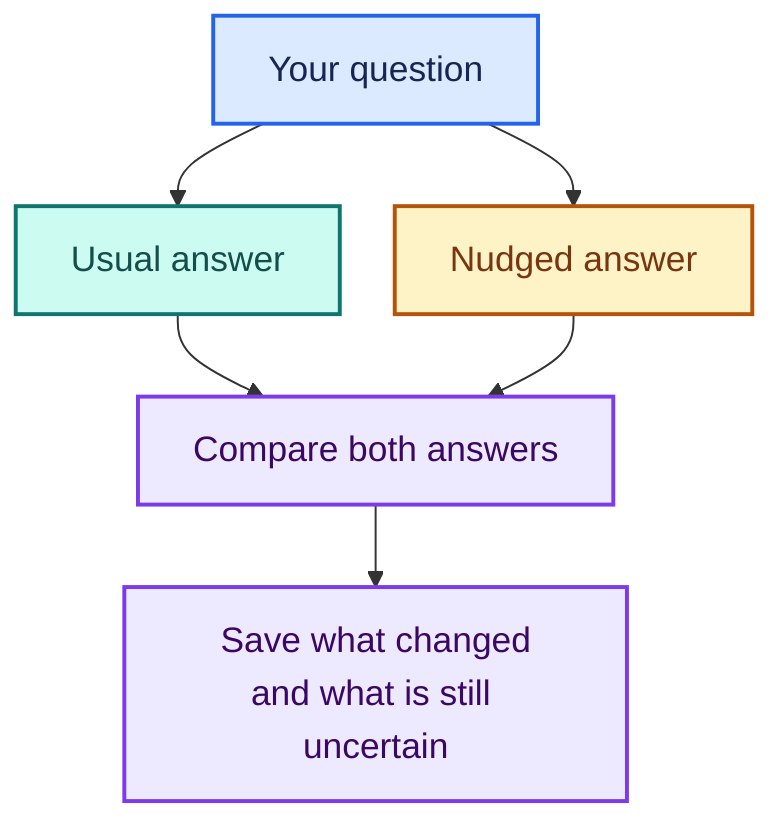

**Key point:** A changed answer is an observation. It is not automatically a better
answer.

Imagine a storyteller with a mixing desk inside. A baseline asks the question
with the desk untouched. Steering temporarily adds a signal at a chosen place.
The comparison shows what happened for this question, dose, model and settings.

The saved weights do not change. Changed wording alone does not show improved
accuracy, safety or quality. Read the full answers and use explicit measurements.

## 2. Choose a command

> **ELI5:** Choose the tool that answers your question: look inside, watch activity,
> write text, compare results, or explore research.

| Command | Use it to… |
| --- | --- |
| `inspect` | Read a local model’s configuration and template names without loading weights. |
| `inspect --load` | Load existing weights and check supported layers, widths and projection layouts. |
| `probe` | Rank candidate coordinates from a prompt file and selected layers. |
| `generate --baseline` | Write one response to an explicit prompt without steering. |
| `generate --neuron L:N:d` | Write one response with your chosen temporary intervention. |
| `evaluate` | Compare prompts under paired conditions and save reports/checkpoints. |
| `neuronpedia` | Look up research IDs/features or analyze explicitly supplied text on the service. |

Open the visual command map

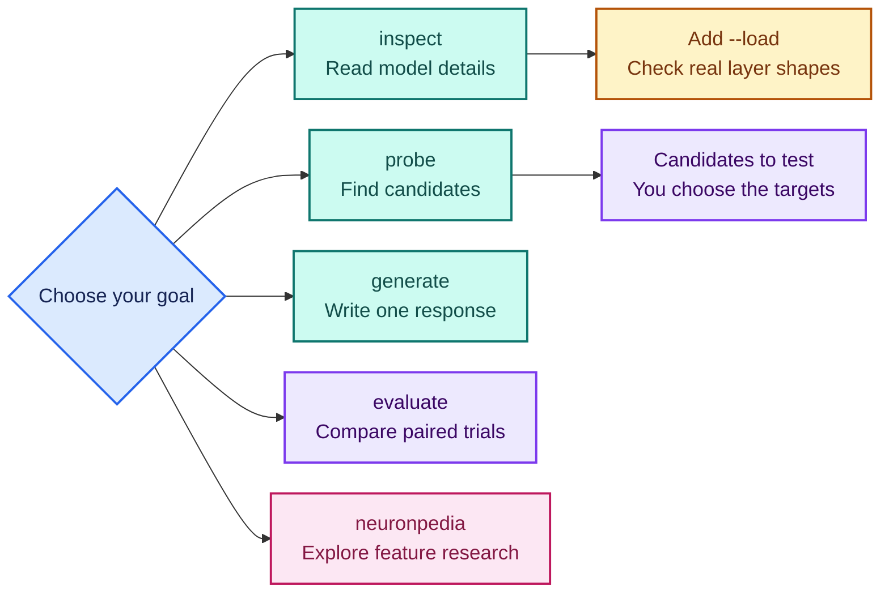

**Key point:** Start with inspect if you do not yet know your model’s supported
layers.

Baseline generation does not require a recognized MLP layout. Native interventions
and probes do. Loaded inspection verifies structure; a successful forward is
needed to verify actual execution.

## 3. The complete research workflow

> **ELI5:** Look first, find ideas to test, then compare them fairly using new
> questions.

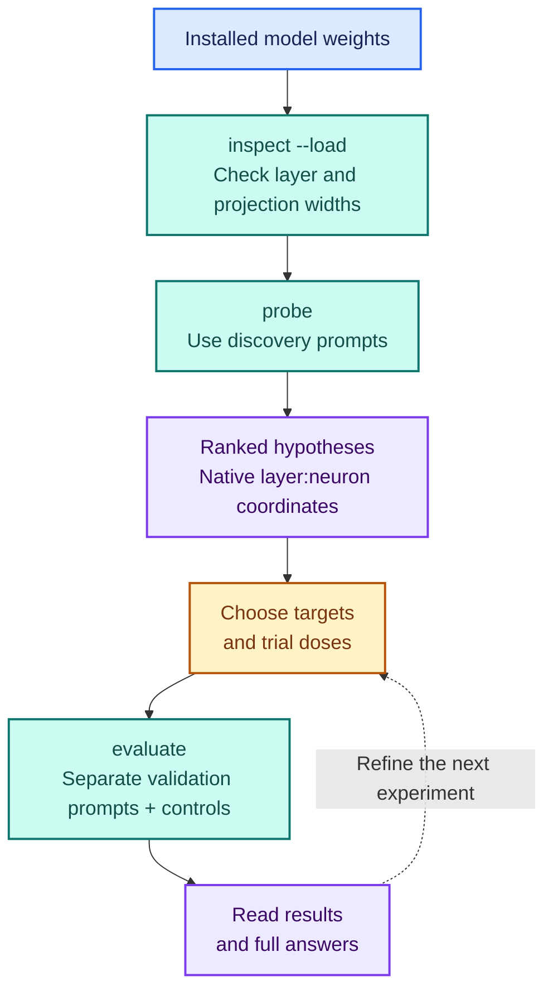

**Key point:** Discovery prompts suggest targets. Separate validation prompts test
those targets.

Use discovery prompts to propose candidates, then separate validation prompts
to test their effects. The program does not automatically pick the best semantic
feature, optimize a dose, train weights or reserve a hidden validation split.
You choose those experimental decisions explicitly.

Neuronpedia can supply research context at any stage. A reference URL does not
change local targets, and a native neuron is not automatically an SAE feature.

## 4. From text to model inputs

> **ELI5:** The model reads numbered text pieces. A template puts your question into
> the format the model expects.

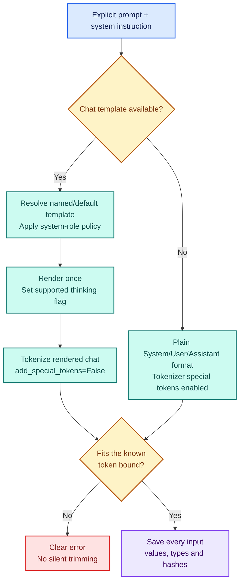

**Key point:** Save all actual inputs, including masks and segment labels, so a
comparison can be replayed.

Details: text formatting, roles and thinking controls

A template turns role-labeled messages into the text the model expects.
`--chat-template NAME` selects a named template. `--system-role auto` retries a
recognized system-role rejection with the instruction merged into the user
message; `merge` selects that form directly and `strict` disables the fallback.
Syntax and unrelated template errors propagate.

Rendered chat is tokenized without adding special tokens again, avoiding a second
BOS token. Plain fallback keeps the tokenizer's normal special tokens. The
thinking flag is passed only when the resolved template advertises it; requesting
it is not proof that the model follows it.

A generation budget includes input plus requested completion tokens. A probe
checks its input-only bound. Reports retain complete tokenizer tensors, including
attention masks and token types when present, so replay is not based on IDs alone.

## 5. What a neuron coordinate means

> **ELI5:** A coordinate is an address inside the model, like a floor and room number.
> It is not the name of an idea.

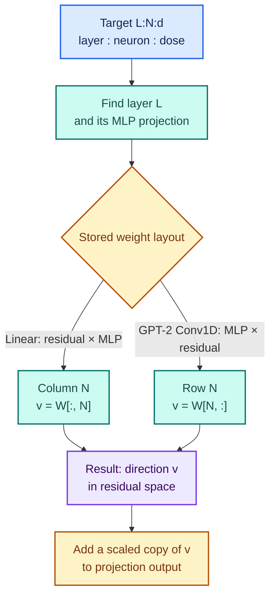

**Key point:** The address selects a direction from this model’s weights; it does not
identify a universal concept.

Details: coordinate meaning and tensor layout

`L:N:d` means decoder layer **L**, projection input coordinate **N**, and signed
**dose d**. For a standard Linear layer, column N describes the residual-space
contribution associated with that MLP coordinate. GPT-2 stores the same kind of
mapping transposed, so the implementation selects a row.

If the MLP input activation at coordinate N is `a[N]`, its linear contribution is
`a[N] × v`. Steering adds a separate calibrated multiple of `v` to the output.
It does not directly overwrite `a[N]`, assign a semantic concept, or include the
projection bias in the selected vector.

Dense floating-point weights and supported layouts are required. Actual loaded
widths determine valid coordinates within the parser's outer bounds.

## 6. Dose and calibration

> **ELI5:** Dose is a volume knob. Calibration measures the current signal so the knob
> has a useful reference level.

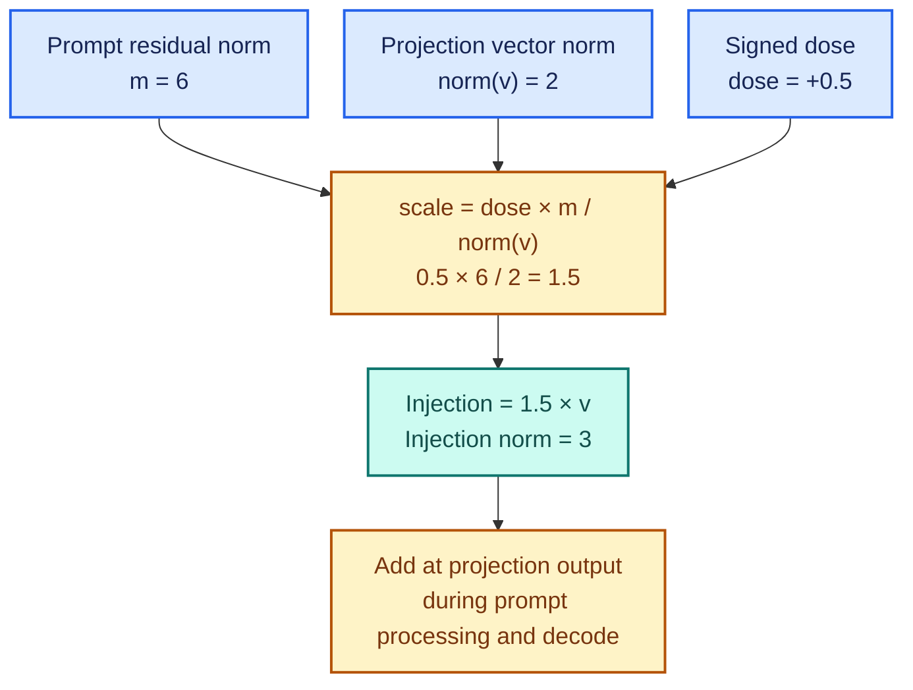

**Key point:** A dose controls how much signal is added, not how good the answer will
be.

Details: calibration policy, formula and rounding

First run the prompt without steering. At each selected decoder block, measure
residual-vector norms and take their median: `m`. The default `skip-first`
calibration excludes position zero for multi-token prompts; `all` includes it.
A single-token prompt uses its only position. This is a positional policy, not a
BOS-token detector. PyTorch's median uses the lower middle value for an even count.

The rule is `injection = dose × m / norm(v) × v`. Thus injection norm is
approximately `abs(dose) × m`, after dtype rounding. Negative doses reverse the
addition; zero doses still calibrate and install zero-vector hooks. An unhooked
baseline does neither.

Multiple targets add vectors, and their directions can reinforce or cancel.
Their combined norm need not equal the sum of individual norms. Calibration is
fixed for one generation; it does not adapt after every generated token. Invalid
norms, non-finite values and destination-dtype overflow produce errors.

## 7. Temporary hook lifetime

> **ELI5:** A hook is a temporary instruction: whenever this part runs, watch it or
> add the chosen signal. Remove the instruction afterward.

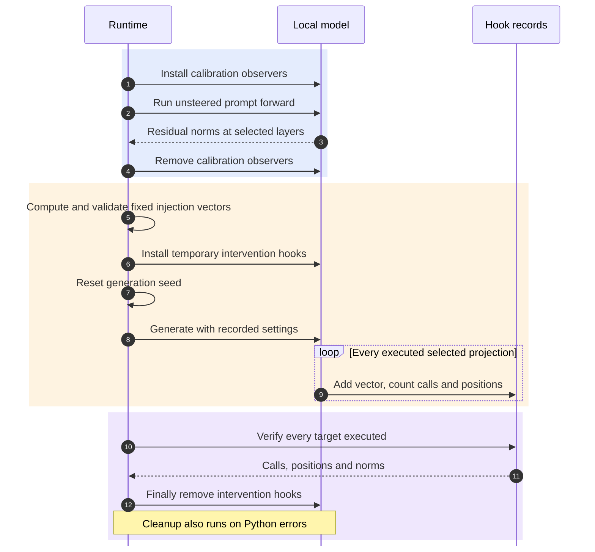

**Key point:** Installed means attached. Applied means the selected part actually ran.

Details: execution evidence and cleanup

A hook is a temporary callback attached to a module execution. Calibration
observers collect norms. Intervention hooks then add fixed vectors during prompt
processing inside generation and subsequent decode calls. Reports distinguish
**installed** from **applied**: every requested target must actually execute.
Call and position counts show what ran; they are not a behavioral success score.

Python returns and exceptions remove handles in `finally`. A hard worker kill
instead discards the process and its memory; it does not promise that Python
cleanup code ran. Either way, source weight files are not edited.

## 8. How probing finds candidates

> **ELI5:** Watch which indicator lights change for different questions. Use those
> observations to choose what to test next.

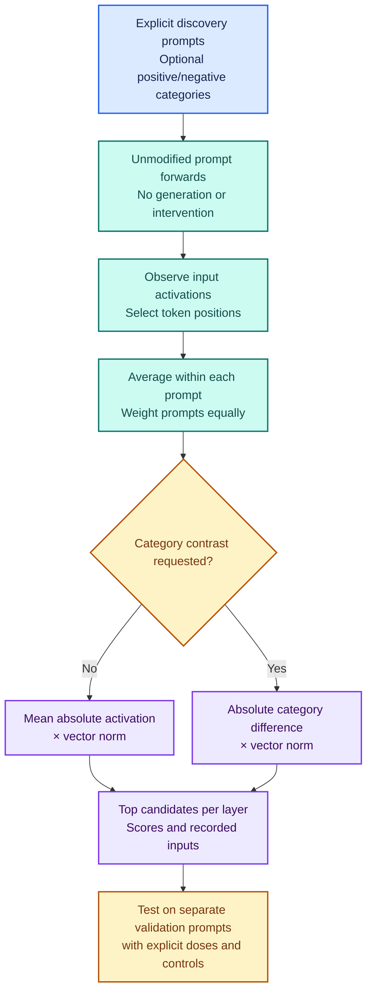

**Key point:** A high probe score is a candidate to investigate, not proof of a useful
intervention.

Details: scoring formulas, weighting and limits

A probe observes projection **inputs**, rather than changing them. Forwards use
evaluation/inference mode, disabled KV caching, and seed zero. No tokens are generated. The default
`last` position is the last formatted input token, often an assistant prefix.
`all` averages every position; `skip-first` excludes position zero when possible.
Each prompt has equal weight regardless of length.

Without category contrast, score is `mean_p(mean_t(abs(a[p,t,j]))) × norm(v[j])`.
With contrast, compute signed per-prompt means, average within each category,
subtract negative from positive, then rank `abs(difference) × norm(v[j])`.
The report preserves the sign separately from the ranking magnitude. Ties use
ascending neuron coordinates.

A large score is an observed contribution or category difference. It does not
identify a truthful neuron or prove which steering sign improves a response.
Prompt wording, template tokens and category imbalance can influence discovery.
The implementation returns top candidates and aggregates rather than full
activation tensors. Bounds: 64 selected prompts, 1–8 layers, up to 64 candidates
per layer, and up to 4,096 input tokens per prompt (512 by default).

## 9. Seeds, dose sweeps and controls

> **ELI5:** Compare the chosen nudge with no nudge, a zero nudge, a random nudge, and
> other checks. Start each paired run with the same dice setup.

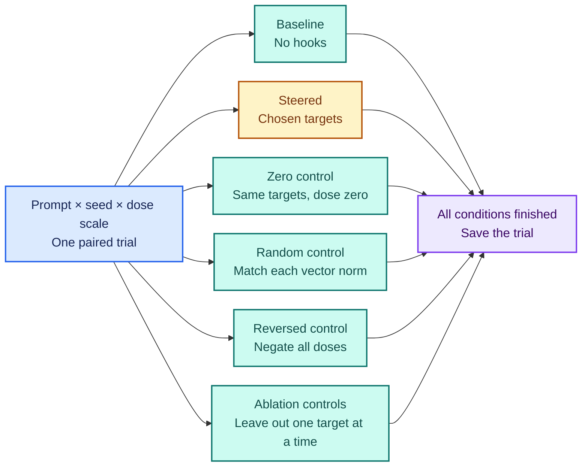

**Key point:** A trial contains all requested conditions for one question, seed and
dose scale.

Details: control arms, seeds and generation counts

A **trial** is one prompt at one seed and one dose scale. The same seed is reset
before every arm, after calibration, so paired sampling starts from the same RNG
state. Hardware/library changes can still alter results. Repeated seeds in greedy
decoding do not create independent behavioral evidence.

| Arm | Purpose | Interpretation limit |
| --- | --- | --- |
| Baseline | Observe the unhooked model | It has different execution costs from calibrated arms |
| Steered | Test selected vectors and doses | A change is not automatically an improvement |
| Zero | Exercise zero-vector hooks | It still runs calibration |
| Random | Compare norm-matched random directions | Individual norms match; combined multi-target norms may differ |
| Reversed | Reverse the selected directions | Opposite sign need not produce an opposite semantic effect |
| Ablation | Leave one target out in each control | With one target, the omitted-target arm is unhooked |

Only baseline and steered are mandatory. `--order alternate` swaps their order
on every second trial; requested controls run afterward. `baseline-first` fixes
the main-arm order. It does not fully randomize all arms.

Example: **3 prompts × 3 seeds × 3 scales = 27 trials**. With one target and all
four control families, each trial has six arms: **162 generations**. For multiple
targets, ablation adds one arm per target. Planning is capped at 10,000 trials
and 100,000 generations; use `--dry-run` to inspect the actual count.

## 10. What the scores establish

> **ELI5:** Check answers against your answer sheet. Keep track of how many answers
> were scored and how many may have been cut short.

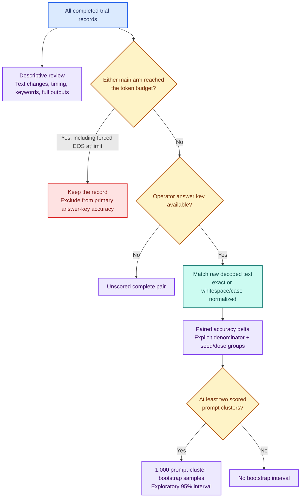

**Key point:** Matching this answer key does not prove that the model is generally
truthful.

Details: answer matching, exclusions and uncertainty

`content` is decoded text with edge whitespace stripped. `raw_content` preserves
that whitespace and is used for operator answer-key matching. Exact matching
compares the entire raw string; normalized matching collapses whitespace and
casefolds. Neither uses substring guesses or a semantic AI judge.

Either main arm reaching its token budget excludes the pair from primary
answer-key accuracy, including when EOS was forced at the limit. The report
retains those outputs and includes them in all-record descriptive metrics.
Exclusion is conservative: it signals possible truncation, not a proven failure.

Summaries expose denominators, baseline/steered accuracy, paired delta, per-prompt
macro delta, seed/dose groups and control comparisons. With at least two scored
prompt clusters, a deterministic 1,000-replicate bootstrap estimates an exploratory
95% interval over prompt-cluster means. It has no multiple-comparison correction.
Repeated seeds for the same prompt are clustered rather than treated as wholly
independent questions. Supplied answer keys can be wrong; an interval or keyword
count does not establish general truthfulness, safety or causal attribution.

## 11. Manifests and reproducibility

> **ELI5:** Keep both the recipe and the receipt: what you planned and what the
> computer actually used.

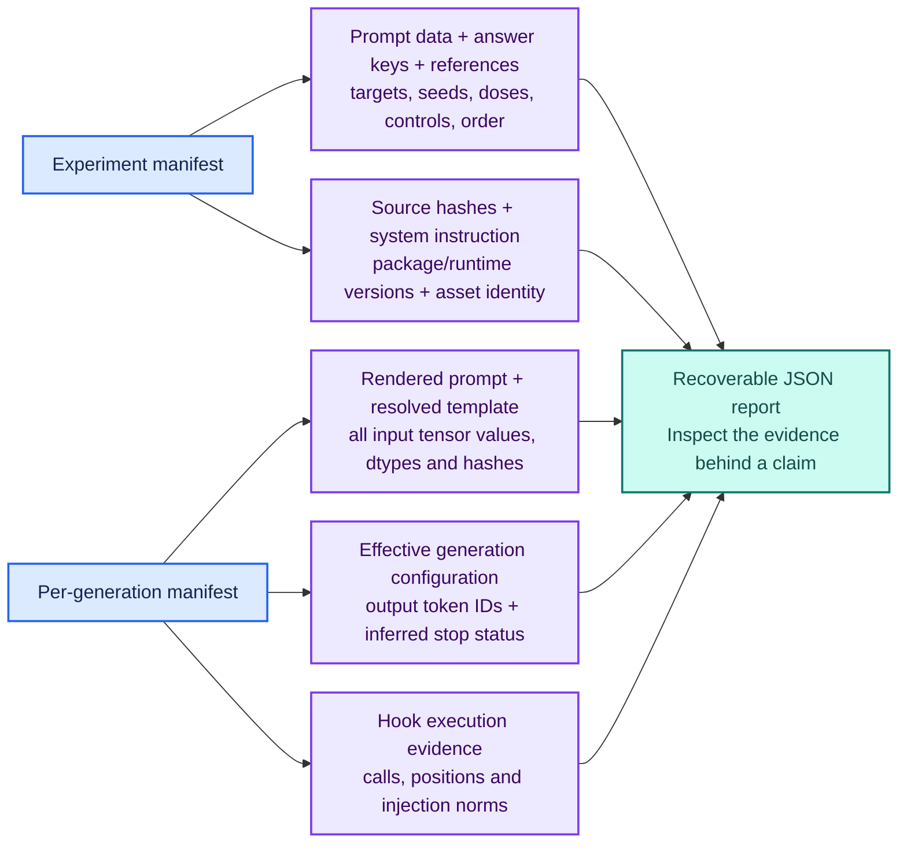

**Key point:** Recorded inputs and settings make differences easier to investigate;
they do not promise identical results everywhere.

Details: identity, hashes and reproducibility

Think of a manifest as an experiment recipe plus its actual execution record.
The top-level recipe describes the dataset, intervention, source and environment.
Per-generation records describe the exact formatted inputs and inherited decoding
settings that were actually used. Probe records likewise retain their inputs,
position counts and ranking policy.

Default asset identity uses relative names, sizes and mtimes for tracked files.
`--asset-identity sha256` also hashes their content, which takes time for large
weights and shares the command deadline. Source files are hashed separately.
Metadata mode cannot detect every edit; neither mode signs the report or prevents
hostile local tampering. A manifest supports investigation and compatible resume;
it does not guarantee bitwise equality on another device or runtime.

## 12. Saving and resuming experiments

> **ELI5:** Save progress after a whole round. If a round is interrupted, keep the
> finished rounds and redo the unfinished one.

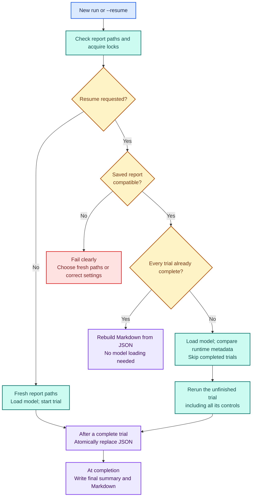

**Key point:** An experiment checkpoint saves results and progress. It is not a newly
trained model.

Details: resume validation and atomic reports

JSON is the recovery checkpoint. It is written only after a whole trial and its
requested controls finish. If interrupted mid-trial, resume keeps earlier complete
trials and reruns that partial trial. JSON and Markdown are independently atomic;
a crash can leave newer JSON and older Markdown.

`--resume` requires an existing compatible **v3** checkpoint. Data, references,
source/system policy, model asset identity, package/runtime settings and report
paths participate in identity; partial resumes also compare loaded runtime
metadata. Changed identity requires new paths. Old v1/v2 checkpoints cannot resume,
and a package/source change such as 0.3.0 to 0.4.0 also requires fresh paths.

Report paths are checked against model/input files and each other, reject symlink
outputs, and acquire non-blocking advisory locks. New runs refuse existing report
files. These protections cover cooperative local use, not hostile filesystem races.

## 13. Neuronpedia and coordinate systems

> **ELI5:** Neuronpedia is a library of feature research. Its feature addresses and
> your model’s native neuron addresses use different maps.

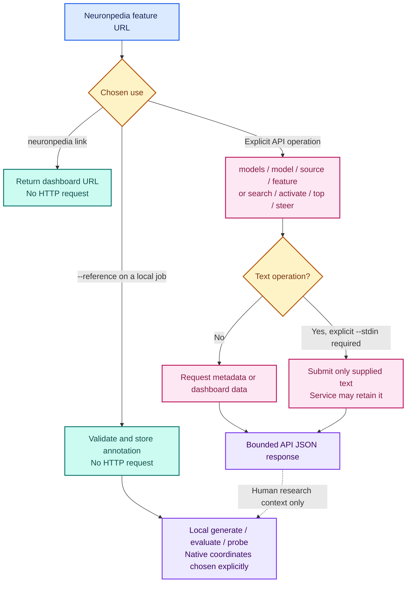

**Key point:** A saved reference is a note. It does not download a vector or choose a
local target.

Details: SAE coordinates, API operations and data handling

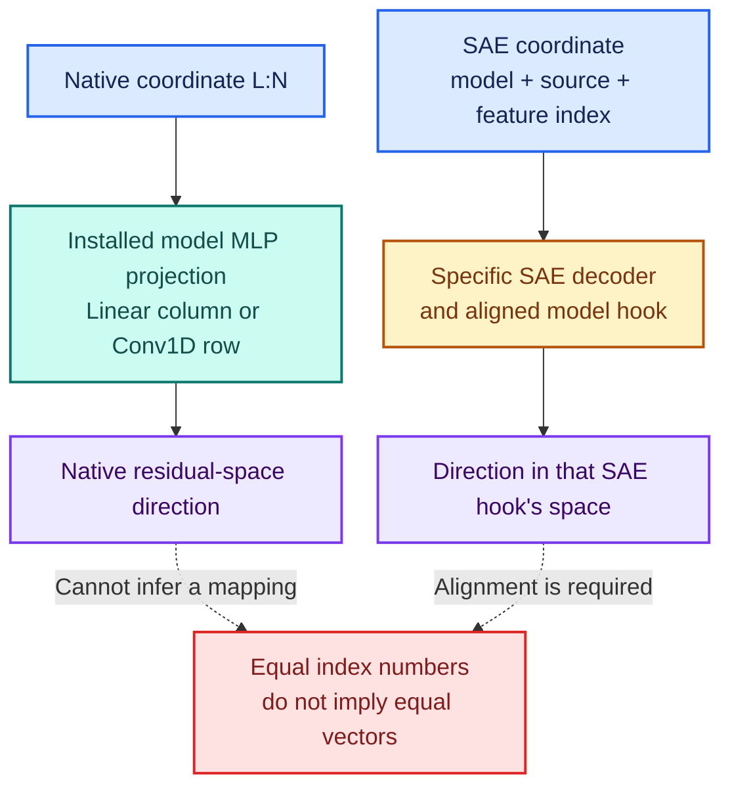

A **native MLP neuron** is an input coordinate of the installed model's MLP output
projection. An **SAE feature** is a latent coordinate of a particular sparse
autoencoder attached at a particular model/hook. Even equal index numbers can
mean entirely different directions. Correct SAE steering would require the right
decoder, model and hook alignment; this implementation does not perform that mapping.

`models`, `model`, `source` and `feature` retrieve public research resources.
`search` searches explanations; `activate` requests feature activations; `top`
requests prominent features; `steer` requests service-side steering. The four text
operations require explicit `--stdin`. `link` constructs a dashboard URL offline.
Any API operation with `--dry-run` previews the plan without making its request.

Remote API access uses the allowed official HTTPS origin, verified certificates,
bounded responses and optional credentials from a named environment variable.
A configured loopback Neuronpedia webapp is also supported. The package does not
start services; a loopback gateway can itself forward externally. Hosted text may
be retained or shared. Local reference annotations never fetch the URL, submit
text, or install a feature vector. See [the API guide](NEURONPEDIA.md) for payloads,
self-hosting, limits and concrete examples.

## 14. Preview, runtime and device choices

> **ELI5:** A preview checks the plan. A real run opens the model and asks an
> available CPU or GPU to do the work.

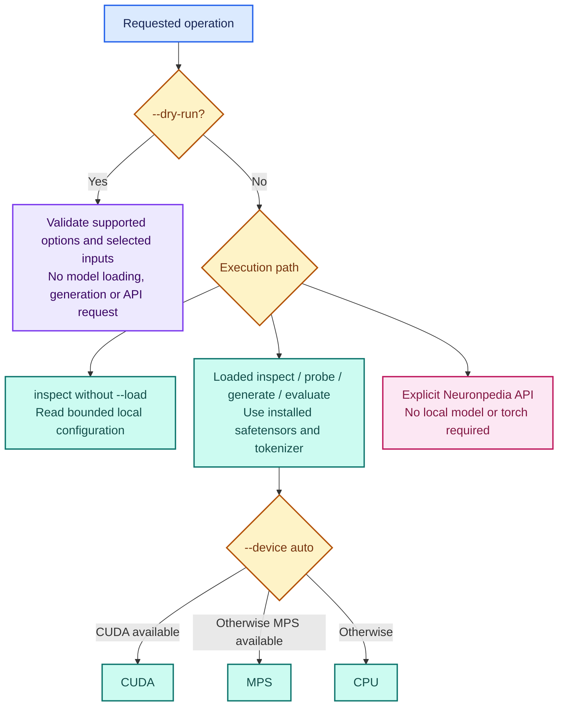

**Key point:** Previewing a plan does not prove the model fits in memory or supports
the chosen coordinate.

Details: runtimes, devices and previews

Core imports, static inspection, dry-runs and the API client need no torch or
Transformers. Loaded inspection and local forwards need the optional runtime and
an existing local safetensors checkpoint/tokenizer. Offline loading is library
configuration with remote model code disabled, not an OS network sandbox.

`--device cpu`, `mps` and `cuda` explicitly select a device. `auto` prefers CUDA,
then available MPS, then CPU. Availability, enough memory, supported model code
and compatible library versions remain execution requirements.

Dry-run checks operation-specific plans. Evaluation/probe previews validate their
selected prompt inputs; they do not load weights, prove dimensions or guarantee
that the model fits. Static inspection reads configuration claims only. Loaded
inspection checks structure; probe/generation supply execution evidence.

## 15. Bounds and error handling

> **ELI5:** Give the job a timer and size limits. If it fails, stop the temporary work
> and return a clear explanation.

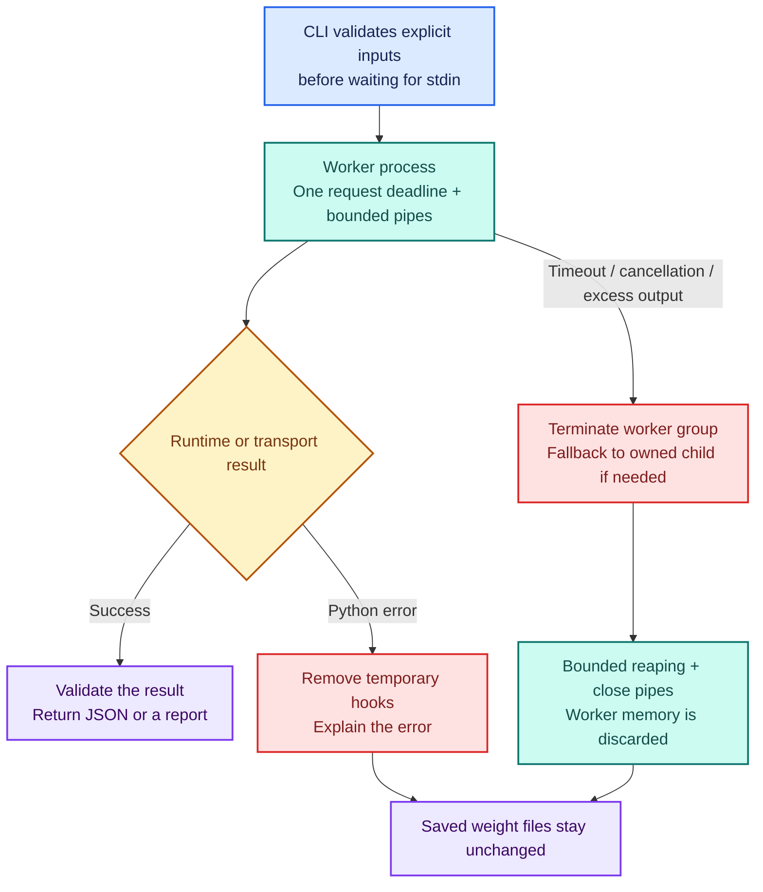

**Key point:** The checks cover implemented paths; they are not a guarantee that every
model works.

Details: bounds, failures and process cleanup

The CLI starts a total request deadline, validates options, and only then reads
explicit stdin where needed. Live work runs in a child with bounded stdout/stderr.
Both pipes are drained to avoid deadlock; strict JSON rejects malformed or
non-finite payloads. Timeouts and output overflow trigger cleanup rather than
an automatic provider switch or retry.

The worker's process group is terminated on forced cleanup. On macOS group
permission races, cleanup falls back to the owned child, bounds reaping to one
second, and closes pipes. An unkillable process produces a cleanup error. A normal
Python model error also removes installed hooks before the worker exits.

Generation defaults are copied and recorded, with one beam and one returned
sequence enforced. Invalid target ranges, zero/non-finite projection norms,
non-finite injected outputs and dtype overflow fail explicitly. These checks
bound the implemented paths; they are not proof of every model's correctness.

## 16. Glossary and a worked experiment

### Text and conversation

| Concept | ELI5 meaning |
| --- | --- |
| **Token** | A small numbered piece of text. The model works with these numbers. |
| **BOS / EOS** | Special start/end markers. An end marker at the token limit may have been forced. |
| **Template / role** | The conversation format and labels, such as user or assistant. |
| **Attention mask** | A marker telling the model which input positions to pay attention to. |
| **Token type IDs** | Optional segment labels used by some models. |
| **Context window** | How much input and output token space the model can handle. |

### Inside the model

| Concept | ELI5 meaning |
| --- | --- |
| **Weights** | Saved settings learned during training. Steering does not rewrite their files. |
| **Activation** | A value produced for the current question, like an indicator reading. |
| **MLP** | A feed-forward part of a model layer that transforms the current representation. |
| **Residual stream** | The model’s running working notes as a question moves through its layers. |
| **Projection vector** | A direction for adding one coordinate’s contribution to those working notes. |
| **Vector norm** | The length, or magnitude, of a vector. |
| **Hook** | A temporary callback attached to a part of the model. |
| **dtype** | The number format, such as float32 or bfloat16; it affects precision and rounding. |
| **Inference / eval** | Run the model without training; disable gradient tracking and training behavior such as dropout. |
| **KV cache** | Stored attention states that can save repeated work during generation; probing disables caching. |

### Running an experiment

| Concept | ELI5 meaning |
| --- | --- |
| **Calibration** | Measure a reference signal level before deciding the size of a nudge. |
| **Dose** | The signed strength of the added signal, relative to that reference level. |
| **Seed** | The starting setup for the random generator, like setting up the same dice. |
| **Temperature** | A generation setting: zero chooses non-sampling generation; positive values enable sampling. |
| **Arm** | One condition in a comparison, such as baseline, steered, or random control. |
| **Trial** | One question at one seed and dose scale, including all requested arms. |
| **SAE feature** | A coordinate in a specific sparse autoencoder. Its address is not a native MLP neuron address. |

### Reading and saving evidence

| Concept | ELI5 meaning |
| --- | --- |
| **Prompt cluster** | All trials sharing the same original question, kept together when estimating uncertainty. |
| **Bootstrap** | Repeatedly resample question groups to estimate how much a measured result might vary. |
| **Manifest** | The recipe and receipt for an experiment: settings, identities and actual inputs. |
| **Checkpoint** | A save point containing completed trials. It saves experiment progress, not trained weights. |

### A worked experiment

Suppose you want to explore arithmetic prompts versus greetings:

1. Run `inspect` to read config, then `inspect --load` to verify a supported layer.
2. Run `probe` on `examples/contrast-prompts.json` with `--positive arithmetic`
   and `--negative greeting`. Save the JSON and inspect the category counts.
3. Select a returned coordinate and an exploratory dose. Inspect both baseline
   and steered text with `generate`; the ranking does not choose a useful dose.
4. Prepare separate validation prompts with reliable answer keys. Run `evaluate`
   with repeated sampling seeds, dose scales and zero/random/reversed/ablation
   controls. Preview the generation count with `--dry-run` first.
5. Check exclusions and complete-pair denominators, compare control effects,
   inspect uncertainty and read the actual responses. Treat findings as specific
   to the recorded experiment until independently validated.
6. Preserve JSON, Markdown and manifests. Use compatible `--resume` after an
   interruption; choose fresh paths when identity changes.

The runnable discovery and evaluation commands are in the
[README examples](README.md#examples). The exact tensor math and ownership rules
are in [design.md](design.md); API-specific examples live in
[NEURONPEDIA.md](NEURONPEDIA.md).

Diagrams use editable Mermaid flowcharts and sequence diagrams with explicit
colors and accessible descriptions. Syntax references:
[flowcharts](https://mermaid.js.org/syntax/flowchart.html) and
[sequence diagrams](https://mermaid.js.org/syntax/sequenceDiagram.html).
