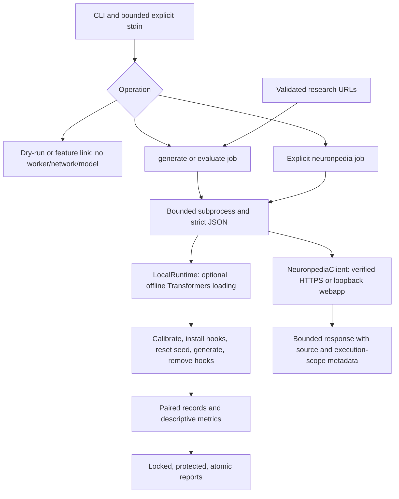

# Design: local neuron steering and Neuronpedia research

Version 0.2.1 · 2026-11-15

This document explains what the program actually computes, which component owns
each step, how results can be reproduced, and where the guarantees end. The CLI
has two execution domains: local dense-MLP steering, and explicitly requested
Neuronpedia API research. A research URL can be recorded with a local experiment
without contacting the website or changing the local target selection.

## 1. Goals and boundaries

The local path loads an existing Transformers causal-language-model checkpoint,
generates a response, and optionally adds calibrated projection vectors through
temporary hooks. Evaluation compares the same explicit prompt under an unhooked
baseline and the chosen intervention. No model-weight file is edited.

The Neuronpedia path exposes public model/source metadata, feature dashboards,
explanation search, activation analysis and service-side steering. It works
without torch, a local checkpoint or a Neuronpedia Python SDK. Its HTTP client
uses the standard library. The CLI reads no call/message history, Contacts,
browser state or unrelated private prompt files in either path. Evaluation uses
its explicitly selected prompt file or the documented bundled prompt set.

Neuronpedia SAE features and native MLP neurons use different coordinate systems.
This implementation does not download SAE decoders, translate an SAE feature into
a local MLP index, apply downloaded vectors, instrument Ollama/GGUF, or assert
that a Neuronpedia feature explains the installed model. Explicit `--neuron`
targets select local hooks. `--reference` URLs are annotations only.

## 2. Components and data flow



| Module | Owns |
| --- | --- |
| `cli.py` | Argument parsing, timeout start, explicit stdin, local dry-run, worker launch, final JSON. |
| `process.py` | Concurrent stdin/stdout/stderr pipes, per-stream limits, elapsed budget, process-group cleanup. |
| `_worker.py` | Private JSON dispatch to local jobs or the explicitly selected Neuronpedia operation; bounded error diagnostics. |
| `jobs.py` | Local-job validation, annotation normalization, model/report paths, paired evaluation and checkpoint identity. |
| `runtime.py` | Optional library imports, local loading, templates, device/context selection, sampling and hook lifetime. |
| `steering.py` | Target parser, supported module layout discovery, calibration and additive hooks. |
| `evaluation.py` | Prompt loading, text metrics, summary tables, escaped Markdown and reference annotations. |
| `storage.py` | Strict JSON, bounded file reads, unique temporary files, flush/fsync and atomic replacement. |
| `neuronpedia.py` | URL/endpoint validation, API payloads, bounded transport, research metadata and offline link/reference helpers. |

A local generation job contains a model-directory path, explicit text, either
`--baseline` or `LAYER:NEURON:DOSE` targets, generation settings and optional
reference URLs. Invalid options fail before the CLI waits for stdin. A
local evaluation job replaces the single prompt with an explicit prompt-file path
and output paths. A Neuronpedia job contains resource identifiers and explicit
text only when the selected API operation needs it. It never goes through
`LocalRuntime` and never loads local weights.

## 3. Local loading and prompt preparation

`LocalRuntime` resolves an existing local directory, then imports torch and
Transformers. Offline environment settings are established before optional imports.
Tokenizer/model loading uses `local_files_only=True` and
`trust_remote_code=False`; model loading also requires safetensors. Missing files
or unsupported architectures produce an error instead of downloading weights.
Offline library flags are not an operating-system network sandbox.

`--device auto` selects CUDA when available, then MPS, then CPU. Explicit devices
are passed to the model and encoded inputs. Availability and memory capacity are
still runtime constraints; the application does not promise that a model fits.

The tokenizer's chat template formats a system message and the exact explicit
prompt. If that template rejects the two-role form, a single-user form combines
the system text and prompt. Without a template, a plain System/User/Assistant
completion format is used. Thinking is disabled only when the template advertises
`enable_thinking`; `--thinking` leaves it enabled. Arbitrary models can implement
different reasoning conventions, so this is not universal reasoning suppression.

The input-token count comes from the encoded sequence. The completion budget is
checked against the smaller positive bound from `--context-size` and known model
`max_position_embeddings`. With only one known bound, that bound is used. With
neither, the model owns context enforcement. The program does not silently trim
the prompt or claim that a larger option expands model context.

## 4. Target meaning and tensor shapes

A target identifies a decoder block `L`, a neuron coordinate `N` of that block's
MLP output projection, and a signed scalar dose `d`. The program supports common
decoder paths `model.layers`, `transformer.h`, and `gpt_neox.layers`, and projection
names `down_proj`, `c_proj`, and `dense_4h_to_h` under a block's MLP.

For a standard Linear projection, the weight has shape
`[residual_width, mlp_width]`. Coordinate `N` selects `W[:, N]`, a vector in residual
space. GPT-2 Conv1D storage is transposed: the weight is
`[mlp_width, residual_width]`, so the same conceptual coordinate selects `W[N, :]`.
Dimension/orientation checks happen against the loaded module. Supported weights
must be two dimensional; recognized quantized/integer representations are rejected.
Unrecognized custom packing is not supported merely because a tensor has two axes.

Explicit `generate --baseline` bypasses projection lookup, calibration and hook
installation. It works with causal models supported by the loader even when their
projection layout is not recognized. Its result reports `mode: baseline`; a job
with targets reports `mode: steered`, including zero-dose targets.

The target parser accepts up to eight unique targets, block indices 0–255, neuron
indices 0–1000000, and finite doses in ±10. These are outer validation bounds.
The loaded model imposes the actual, usually smaller, layer/neuron dimensions.
A target for one architecture is not a portable behavioral label for another.

## 5. Calibration and intervention, step by step

For each selected decoder block, a temporary calibration hook observes the output
of an unsteered prompt forward pass. If the block returns a tuple, its first item
is used as the hidden state. Expected shape is `[batch, tokens, residual_width]`.
The CLI operates on one prompt, and calibration uses batch element zero.

For multiple prompt positions, position zero is excluded. This is a positional
rule; the program does not inspect whether that token is actually BOS. For a
single-position prompt, its one position is used. Each selected hidden vector is
converted to float32 before computing its Euclidean norm. `torch.median` supplies
the calibration value, including its lower-middle convention for an even count.
Calibration hooks are removed even if the forward pass or a later target fails.

Let `h[L,t]` be the residual vector leaving block `L` at prompt position `t`, and
let `v[L,N]` be the selected projection vector. The program computes:

```text
m[L]     = median_t ||h[L,t]||₂
c[L,N]   = ||v[L,N]||₂
s[L,N]   = d[L,N] × m[L] / c[L,N]
a[L,N]   = s[L,N] × v[L,N]
```

At the projection's output hook:

```text
projection_output[..., :] += a[L,N]
```

The vector broadcasts across batch/token positions. It is applied during prompt
processing inside generation and subsequent decode steps. Its magnitude is
approximately `abs(d) × m[L]`; its sign follows the dose. For example, median
residual norm 6, projection-vector norm 2 and dose 0.5 yield scale 1.5 and an
injected-vector norm of 3.

Scaling is computed in float32, then cast to the projection's dtype/device. The
program rejects zero/non-finite projection norms, invalid residual calibration,
non-finite scales, and vectors that overflow the destination dtype. A finite
injection alone does not prove that all subsequent model activations stay finite.

All targets are calibrated from the same unsteered prompt pass. Their fixed
vectors are not recalibrated as other interventions change downstream states.
Multiple targets in one projection add their vectors through separate hooks.
A zero dose installs a zero-vector control; a paired baseline installs no hooks.
Those are distinct execution paths, even when their intended output perturbation
is zero. The hook adds a projection-output contribution; it does not directly set
an internal neuron's preactivation value.

## 6. Generation, cleanup and output interpretation

The runtime resets the seed immediately before generation, after any calibration.
This prevents calibration from consuming RNG state intended for a paired sample.
Temperature zero selects non-sampling generation; positive temperatures enable
sampling. Other model generation defaults can still influence decoding.

`return_dict_in_generate=False` ensures that generated sequences have the tensor
shape expected by the slicing/decoding path. Only newly generated token IDs are
decoded, with special tokens skipped; the returned content is stripped at its
edges. Output-token counts therefore refer to tokens, while metrics compare the
final decoded/stripped strings. Empty output is a possible model result.

`reached_token_budget` reports that the generated count met the output budget and
the final token was not one of the configured EOS IDs. It is a useful exhaustion
signal, not a universal explanation of every model-specific stopping rule.

Every installed steering handle is removed in a `finally` block. A generation
exception therefore cannot leave hooks on a runtime reused for the next prompt.
The CLI's process wrapper also terminates the worker process group on timeout or
cancellation. In-memory weights disappear with the worker; weight files remain
unchanged. Direct Python users own their process lifetime.

## 7. Paired evaluation and descriptive metrics

An evaluation loads the model once. For each explicit prompt, it generates an
unhooked baseline and a steered response with the same prompt, settings and seed.
Completed records contain both texts, token counts, elapsed times and intervention
calibration. The steered elapsed time includes calibration; this comparison is
not a pure decoder-throughput benchmark.

Metrics include exact-text change, normalized text similarity using
`difflib.SequenceMatcher`, character lengths and fixed English keyword counts.
Keyword matches can reflect negation, quotations, sarcasm or unrelated contexts.
These metrics do not measure causal attribution, safety, factuality or quality.
The report keeps complete outputs so users can inspect what actually changed.

Prompt JSON is limited to 8 MiB, 10000 records, and 200-character category labels.
Each prompt is bounded to 10000 characters/40000 UTF-8 bytes. Exact prompt
whitespace is preserved. The default package includes a 100-prompt set and smaller
screening/example sets; installing the wheel includes those resources.

## 8. Checkpoint state and recovery

Before loading a model for evaluation, both report paths are checked. They must
be distinct, outside the model directory, and must not alias the input prompt
file or model files. Symlink report paths are rejected. A new run refuses existing
JSON or Markdown. Non-blocking advisory locks cover both paths in deterministic
order, including a Markdown file shared by otherwise different JSON outputs.

Checkpoint format v2 stores a fingerprint of selected prompts, targets,
generation settings, references, model path/file metadata, package/Python/runtime
versions and Markdown path. Weight identity tracks relative names, sizes and modification times recursively
for safetensors shards, known configuration/tokenizer/vocabulary assets and
tiktoken files, including nested weight files. Hidden directories and symlinked
directory traversal are not included. This is metadata identity, not a full tensor
hash. Checkpoints are not signed provenance. A partial
resume also compares resolved runtime metadata before generating further pairs.

Records require an integer format version and are validated for unique integer
indices, exact prompt/category,
string content, bounded token counts, finite non-negative elapsed time and metrics
consistent with the texts. Optional input-token counts and budget flags are typed
when present. A missing `--resume` checkpoint fails instead of starting a new evaluation.
A bad checkpoint fails before loading weights.
Changing a recorded reference is also an identity change, even though references
never affect generation. Package-version changes require new report paths for earlier results; old files remain preserved.

After each complete pair, a unique temporary JSON file is flushed/fsynced and
atomically replaces the checkpoint. The JSON limit is 128 MiB. Markdown is
replaced independently with escaped labels and dynamic code fences longer than
any tilde run in generated content. A crash can leave current JSON and stale
Markdown; a completed compatible resume regenerates Markdown without a model.
A partially generated pair is rerun after interruption. Lock files persist, while
OS locks release on exit. Local hostile filesystem races and unusual network
filesystem semantics are outside these cooperative locking guarantees.

## 9. Neuronpedia request flow

`neuron-steer neuronpedia` selects a separate API operation. Public resource
lookups do not require a local model. Search/test/steering operations require
explicit stdin text. `link` and `--dry-run` perform no network request. The local
`generate`/`evaluate` commands never initiate Neuronpedia requests.

| Action | API request | Explicit text |
| --- | --- | --- |
| `models` | POST `/api/model/list` with `{}` | None |
| `model` | POST `/api/model/get` with `id` | None |
| `source` | GET `/api/source-set/MODEL/SET` | None |
| `feature` | GET `/api/feature/MODEL/SOURCE/INDEX` | None |
| `search` | POST `/api/explanation/search` with model, layers, query, offset | stdin query |
| `activate` | POST `/api/activation/new` with feature and customText | stdin test text |
| `top` | POST `/api/search-all` with source set and bounded result count | stdin test text |
| `steer` | POST `/api/steer` with one feature, signed strength and completion settings | stdin prompt |
| `link` | No API request; validate and construct dashboard URL | None |

An official `--url` may replace model/source/index for feature-oriented actions.
Conflicting explicit IDs are rejected. Returned feature identity must match the
requested IDs. API data remains untrusted research material; JSON always reports
`semantic_truth_verified: false` and `local_neuron_targets_applied: false`.

The default is the official HTTPS origin. Only `www.neuronpedia.org` and
`neuronpedia.org` are allowed remotely. An explicitly selected loopback URL can
target a self-hosted Neuronpedia webapp, including a configured path prefix.
`localhost` is pinned to 127.0.0.1; other local addresses must be literal loopback
IPs. The client does not follow redirects or environment proxies, accepts only
identity response encoding, verifies TLS certificates, bounds request/response
sizes and uses strict JSON. A private CA bundle can be selected explicitly.

An optional credential is read from the variable named by `--api-key-env`, and
sent in `x-api-key`. Its value is not placed in argv, URLs or dry-run JSON. Errors
report status/context without echoing response bodies, prompts or auth headers.
The CLI worker's process deadline includes stdin, DNS, connection, headers and
body processing; direct library callers only have socket/elapsed checks, so OS
DNS resolution can outlast their intended deadline.

Responses are limited to 8 MiB, request bodies to 128 KiB and text to the local
prompt bounds. No automatic retry or pagination occurs. This avoids duplicate
service-side generations and surprising bulk retrieval. Hosted text operations
may be stored; explanation search may use upstream embedding services, and
steering can produce saved/shareable output. A loopback gateway can also forward
to external providers. Configure its backend appropriately.

## 10. Connecting research with a local experiment

A research workflow can look up a feature, inspect source/model/hook metadata,
perform an explicit hosted test, and record the URL with a separate local run:

```sh
neuron-steer neuronpedia feature \
  --url https://www.neuronpedia.org/gemma-2-2b/20-gemmascope-res-16k/10956

neuron-steer generate --model /path/to/local/model --neuron 0:0:0 \
  --prompt 'A synthetic example.' \
  --reference https://www.neuronpedia.org/gemma-2-2b/20-gemmascope-res-16k/10956 \
  --dry-run
```

The zero-dose target above is a control. The reference can concern a different
model and remains an annotation; it does not make `0:0` equivalent to feature
10956. Local results/checkpoints/Markdown retain canonical URLs and explicitly
mark the annotation policy. URLs are validated, normalized and deduplicated,
with at most 16 references. No reference is fetched during a local run.

A genuine local SAE intervention would additionally require the exact base model,
SAE decoder weights, feature coordinate, hook location, normalization convention,
and a tested adapter. That capability is not supplied by a dashboard URL alone
and is outside this release.

## 11. Preflight and JSON validation

Local scalar/target/reference options are checked before reading stdin. A local
evaluation dry-run reads and validates its named or bundled prompt data, selected
limit and protected output paths without creating locks/reports or loading weights.
It reports whether the model directory exists and explicitly leaves model dimension
validation false. It does not guarantee that weights fit memory or that a resume
checkpoint is fully compatible; those checks belong to execution.

Strict JSON rejects duplicate keys, explicit NaN/Infinity, numbers that overflow
to infinity (for example `1e999`), invalid/unpaired Unicode surrogates and excessive
nesting. Bounds apply before file parsing and HTTP response decoding. This keeps
decoding, fingerprints and serialization consistent instead of failing late when
writing results.

## 12. Verification and sources

Tests exercise pure payload building, URL/host restrictions, explicit text rules,
credentials, response bounds, malformed JSON, resource identity, real loopback
worker dispatch and hard timeout, plus local steering/checkpoint regressions.
Live checks use public metadata; hosted activation or steering is not invoked
implicitly. Recorded scope and remaining limits live in `verification/` and
[AUDIT.md](AUDIT.md). No universal model compatibility or bug-free claim is made.

The request shapes and model/SAE distinctions are based on primary sources:

- [Neuronpedia API guide](https://docs.neuronpedia.org/api-and-data/api)
- [Resource and source metadata guide](https://docs.neuronpedia.org/getting-started/find-resources)
- [Steering API and methods](https://docs.neuronpedia.org/steering)
- [Official endpoint source](https://github.com/hijohnnylin/neuronpedia/tree/main/apps/webapp/app/api)

See [NEURONPEDIA.md](NEURONPEDIA.md) for command examples and
[ARCHITECTURE.md](ARCHITECTURE.md) for the shorter maintenance overview.
