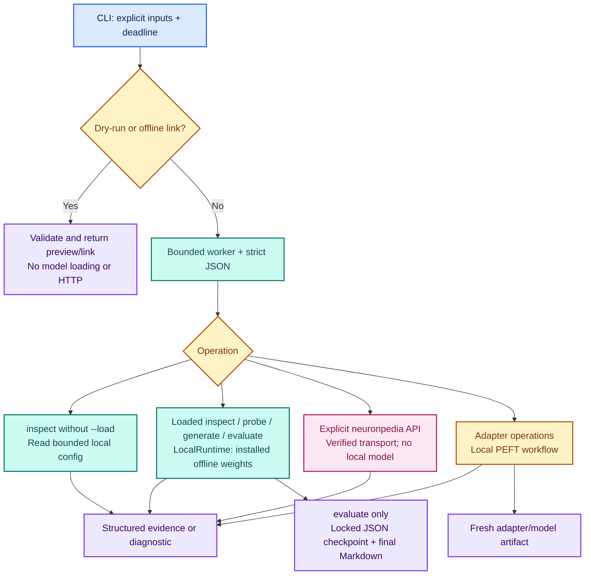
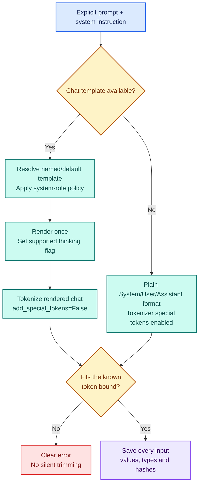
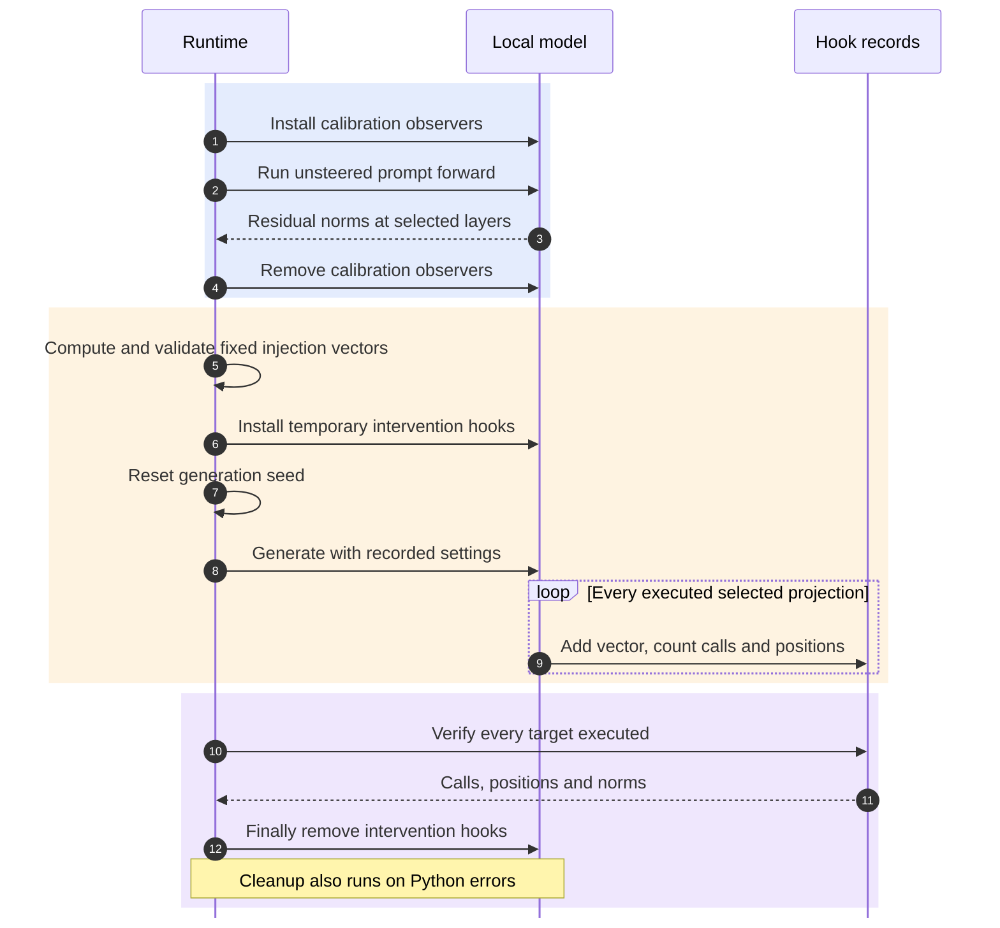
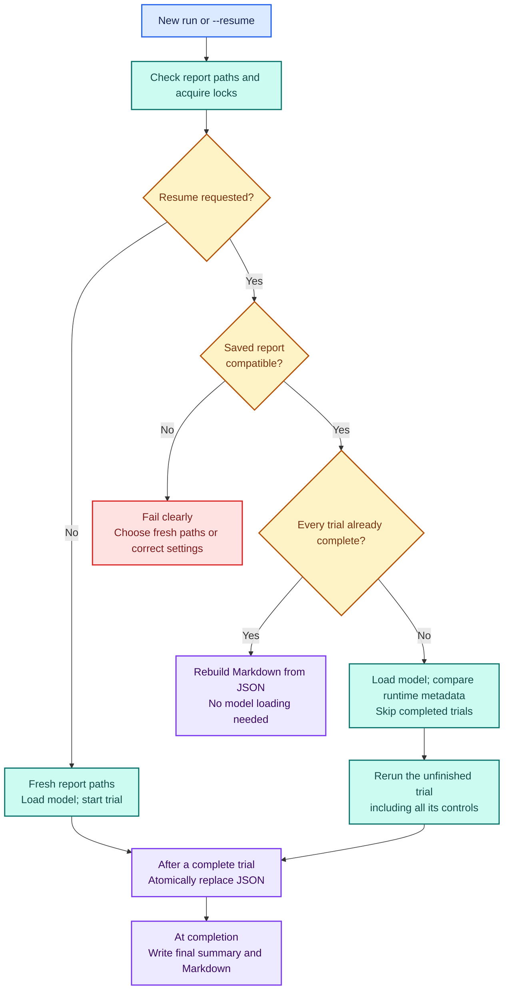
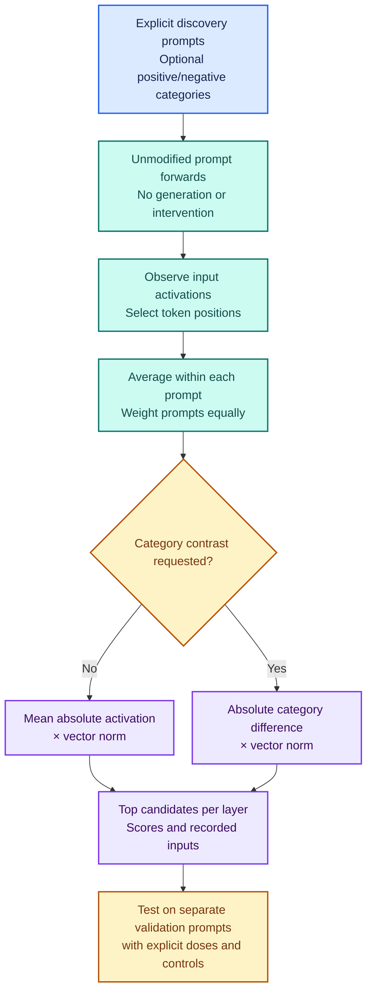

# Design: local neuron steering and Neuronpedia research

Version 0.5.0 · 2026-11-17

This document explains what the program actually computes, which component owns
each step, how results can be reproduced, and where the guarantees end. The CLI
has two execution domains: local model research, and explicitly requested
Neuronpedia API research. Local commands inspect configurations/projections,
profile prompt activations, generate text and compare controlled interventions. A research URL can be recorded with a local experiment
without contacting the website or changing the local target selection.

**Audience:** readers who want the implementation details. For an easier start,
use the [visual guide](VISUAL_GUIDE.md#choose-your-reading-path).

Each section starts with an ELI5 explanation, then gives the exact behavior.
Use [the maintainer overview](ARCHITECTURE.md) for module ownership and development checks.

## 1. Goals and boundaries

> **ELI5:** The tool can look at the model, watch its activity, or try a temporary
> nudge. Research commands save results. Explicit adapter operations can save learned patches and new model copies.

Static inspection reads configuration without loading weights. Other local
research paths load an existing Transformers causal-language-model checkpoint
to inspect supported projections, profile activations or generate responses.
Steered generation adds calibrated projection vectors through temporary hooks. Evaluation compares the same explicit prompt under an unhooked
baseline and the chosen intervention. Existing base-model files are not overwritten; the adapter workflow writes new artifacts.

The Neuronpedia path exposes public model/source metadata, feature dashboards,
explanation search, activation analysis and service-side steering. It works
without torch, a local checkpoint or a Neuronpedia Python SDK. Its HTTP client
uses the standard library. The CLI reads no call/message history, Contacts,
browser state or unrelated private prompt files in either path. Evaluation uses
its explicitly selected prompt file or the documented bundled prompt set.

Neuronpedia SAE features and native MLP neurons use different coordinate systems.
This implementation does not download SAE decoders, translate an SAE feature into
a local MLP index, apply downloaded vectors, instrument Ollama/GGUF, or assert
that a Neuronpedia feature explains the installed model. Explicit `--neuron`
targets select local hooks. `--reference` URLs are annotations only.

## 2. Components and data flow

> **ELI5:** One front door checks the request, then sends it to the part that knows
> how to do the job.



<details>
<summary>Maintainer reference: which module owns each step?</summary>

| Module | Owns |
| --- | --- |
| `cli.py` | Argument parsing, timeout start, explicit stdin, local dry-run, worker launch, final JSON. |
| `process.py` | Concurrent stdin/stdout/stderr pipes, per-stream limits, elapsed budget, process-group cleanup. |
| `_worker.py` | Private JSON dispatch to local jobs or the explicitly selected Neuronpedia operation; bounded error diagnostics. |
| `jobs.py` | Local-job validation, annotation normalization, model/report paths, paired evaluation and checkpoint identity. |
| `runtime.py` | Optional library imports, local loading, templates, device/context selection, sampling and hook lifetime. |
| `steering.py` | Target parser, supported module layout discovery, calibration and additive hooks. |
| `adapters.py` | Response-only LoRA training, managed artifact integrity, held-out evaluation and standalone merge verification. |
| `research.py` | Static/loaded inspection, bounded activation profiles and category-contrast rankings. |
| `experiments.py` | Seed/dose grids, explicit control arms and answer-key matching. |
| `provenance.py` | Recoverable manifests, source hashes and optional asset content identity. |
| `evaluation.py` | Prompt loading, text metrics, summary tables, escaped Markdown and reference annotations. |
| `storage.py` | Strict JSON, bounded file reads, unique temporary files, flush/fsync and atomic replacement. |
| `neuronpedia.py` | URL/endpoint validation, API payloads, bounded transport, research metadata and offline link/reference helpers. |


</details>

A local generation job contains a model-directory path, explicit text, either
`--baseline` or `LAYER:NEURON:DOSE` targets, generation settings and optional
reference URLs. Invalid options fail before the CLI waits for stdin. A
local evaluation job replaces the single prompt with an explicit prompt-file path
and output paths. A Neuronpedia job contains resource identifiers and explicit
text only when the selected API operation needs it. It never goes through
`LocalRuntime` and never loads local weights.

Inspection jobs read config by default and load weights only with `--load`.
Probe jobs identify an explicit prompt file, selected layers, position policy and
optional category contrast. They observe unmodified forwards and return native
coordinate hypotheses, rather than generated responses or trained weights.

## 3. Local loading and prompt preparation

> **ELI5:** Turn your question into the model’s expected format, then check that it
> fits.

`LocalRuntime` resolves an existing local directory, then imports torch and
Transformers. Offline environment settings are established before optional imports.
Tokenizer/model loading uses `local_files_only=True` and
`trust_remote_code=False`; model loading also requires safetensors. Missing files
or unsupported architectures produce an error instead of downloading weights.
Offline library flags are not an operating-system network sandbox.

`--device auto` selects CUDA when available, then MPS, then CPU. Explicit devices
are passed to the model and encoded inputs. Availability and memory capacity are
still runtime constraints; the application does not promise that a model fits.

The tokenizer's chat template formats a system message and the exact explicit
prompt. With the default auto policy, recognized system-role rejection retries a
single-user form combining the system text and prompt. Merge and strict policies
select that format explicitly or disable fallback. Without a template, a plain System/User/Assistant
completion format is used. Thinking is disabled only when the template advertises
`enable_thinking`; `--thinking` requests it enabled. Arbitrary models can implement
different reasoning conventions, so this is not universal reasoning suppression.

The input-token count comes from the encoded sequence. The completion budget is
checked against the smaller positive bound from `--context-size` and known model
`max_position_embeddings`. With only one known bound, that bound is used. With
neither, the model owns context enforcement. The program does not silently trim
the prompt or claim that a larger option expands model context.



The generation branch above reserves completion tokens; probe reserves only its
input tokens. All captured model-input tensors include their dtype and hash.

## 4. Target meaning and tensor shapes

> **ELI5:** A target is an address for a particular direction inside this exact model.

A target identifies a decoder block `L`, a neuron coordinate `N` of that block's
MLP output projection, and a signed scalar dose `d`. The program supports common
decoder paths `model.layers`, `transformer.h`, and `gpt_neox.layers`, and projection
names `down_proj`, `c_proj`, and `dense_4h_to_h` under a block's MLP.

For a standard Linear projection, the weight has shape
`[residual_width, mlp_width]`. Coordinate `N` selects `W[:, N]`, a vector in residual
space. GPT-2 Conv1D storage is transposed: the weight is
`[mlp_width, residual_width]`, so the same conceptual coordinate selects `W[N, :]`.
Dimension/orientation checks happen against the loaded module. Supported weights
must be two dimensional; recognized quantized/integer representations are rejected.
Unrecognized custom packing is not supported merely because a tensor has two axes.

Explicit `generate --baseline` bypasses projection lookup, calibration and hook
installation. It works with causal models supported by the loader even when their
projection layout is not recognized. Its result reports `mode: baseline`; a job
with targets reports `mode: steered`, including zero-dose targets.

The target parser accepts up to eight unique targets, block indices 0–255, neuron
indices 0–1000000, and finite doses in ±10. These are outer validation bounds.
The loaded model imposes the actual, usually smaller, layer/neuron dimensions.
A target for one architecture is not a portable behavioral label for another.

## 5. Calibration and intervention, step by step

> **ELI5:** Measure the usual signal first, then choose how much extra signal to add.

For each selected decoder block, a temporary calibration hook observes the output
of an unsteered prompt forward pass. If the block returns a tuple, its first item
is used as the hidden state. Expected shape is `[batch, tokens, residual_width]`.
The CLI operates on one prompt, and calibration uses batch element zero.

With `--calibration skip-first` (default), position zero is excluded for multiple
prompt positions; `--calibration all` includes every position. This is a positional
rule; the program does not inspect whether that token is actually BOS. For a
single-position prompt, its one position is used. Each selected hidden vector is
converted to float32 before computing its Euclidean norm. `torch.median` supplies
the calibration value, including its lower-middle convention for an even count.
Calibration hooks are removed even if the forward pass or a later target fails.

Let `h[L,t]` be the residual vector leaving block `L` at prompt position `t`, and
let `v[L,N]` be the selected projection vector. The program computes:

```text
m[L]     = median_t ||h[L,t]||₂
c[L,N]   = ||v[L,N]||₂
s[L,N]   = d[L,N] × m[L] / c[L,N]
a[L,N]   = s[L,N] × v[L,N]
```

At the projection's output hook:

```text
projection_output[..., :] += a[L,N]
```

The vector broadcasts across batch/token positions. It is applied during prompt
processing inside generation and subsequent decode steps. Its magnitude is
approximately `abs(d) × m[L]`; its sign follows the dose. For example, median
residual norm 6, projection-vector norm 2 and dose 0.5 yield scale 1.5 and an
injected-vector norm of 3.

Scaling is computed in float32, then cast to the projection's dtype/device. The
program rejects zero/non-finite projection norms, invalid residual calibration,
non-finite scales, and vectors that overflow the destination dtype. A finite
injection alone does not prove that all subsequent model activations stay finite.

All targets are calibrated from the same unsteered prompt pass. Their fixed
vectors are not recalibrated as other interventions change downstream states.
Multiple targets in one projection add their vectors through separate hooks.
A zero dose installs a zero-vector control; a paired baseline installs no hooks.
Those are distinct execution paths, even when their intended output perturbation
is zero. The hook adds a projection-output contribution; it does not directly set
an internal neuron's preactivation value.



This sequence is the steered path. Unhooked baseline generation skips calibration
and intervention hooks. Hard process termination discards worker memory rather
than running Python finally blocks.

## 6. Generation, cleanup and output interpretation

> **ELI5:** Run the model with the chosen settings and remove temporary instructions
> when the run ends.

The runtime resets the seed immediately before generation, after any calibration.
This prevents calibration from consuming RNG state intended for a paired sample.
Temperature zero selects non-sampling generation; positive temperatures enable
sampling. Other model generation defaults can still influence decoding.

`return_dict_in_generate=False` ensures that generated sequences have the tensor
shape expected by the slicing/decoding path. Only newly generated token IDs are
decoded, with special tokens skipped; the returned content is stripped at its
edges. Output-token counts therefore refer to tokens, while metrics compare the
final decoded/stripped strings. Empty output is a possible model result.

`reached_token_budget` reports that the generated count met the output budget,
even with a final EOS (which may have been forced at the limit). The same
conservative flag is exposed as `possibly_truncated`. Stop reasons are inferred,
not a universal explanation of every model-specific stopping rule.

Every installed steering handle is removed in a `finally` block. A generation
exception therefore cannot leave hooks on a runtime reused for the next prompt.
The CLI's process wrapper also terminates the worker process group on timeout or
cancellation. If group signaling returns permission denied, cleanup falls back to
signaling the owned child; reaping is bounded to one second and pipes close even
if termination fails. An unkillable process produces a cleanup error. In-memory weights disappear with the worker; weight files remain
unchanged. Direct Python users own their process lifetime.

## 7. Paired evaluation and descriptive metrics

> **ELI5:** Ask the same questions under different conditions and compare the recorded
> answers.

An evaluation loads the model once. For each explicit prompt, it generates an
unhooked baseline and a steered response with the same prompt, settings and seed.
Completed records contain both texts, token counts, elapsed times and intervention
calibration. The steered elapsed time includes calibration; this comparison is
not a pure decoder-throughput benchmark.

Metrics include exact-text change, normalized text similarity using
`difflib.SequenceMatcher`, character lengths and fixed English keyword counts.
Keyword matches can reflect negation, quotations, sarcasm or unrelated contexts.
These metrics do not measure causal attribution, safety, factuality or quality.
The report keeps complete outputs so users can inspect what actually changed.

Prompt JSON is limited to 8 MiB, 10000 records, and 200-character category labels.
Each prompt is bounded to 10000 characters/40000 UTF-8 bytes. Exact prompt
whitespace is preserved. The default package includes a 100-prompt set and smaller
screening/example sets; installing the wheel includes those resources.

## 8. Checkpoint state and recovery

> **ELI5:** Save finished rounds so an interrupted experiment can continue safely.

Before loading a model for evaluation, both report paths are checked. They must
be distinct, outside the model directory, and must not alias the input prompt
file or model files. Symlink report paths are rejected. A new run refuses existing
JSON or Markdown. Non-blocking advisory locks cover both paths in deterministic
order, including a Markdown file shared by otherwise different JSON outputs.

Checkpoint format **v3** stores both a recoverable `experiment_manifest` and its
SHA256 fingerprint. Identity covers selected prompts and answer keys, targets,
reference annotations, source-file hashes, literal system instruction, generation
and prompt policies, seeds/doses/controls/order, runtime/Python versions, platform
and report paths. Per-generation manifests retain the resolved template, rendered
prompt, exact input/output token IDs and effective `GenerationConfig`.

Model assets include safetensors shards, known configuration/tokenizer/vocabulary,
tiktoken and Jinja files by relative name, size and mtime. Shard-index entries
are validated and included even when located inside a symlinked directory.
Hidden files and unreferenced symlink-directory contents are not recursively
traversed. `--asset-identity sha256` additionally streams content hashes of tracked
assets; it shares the worker timeout. Metadata mode cannot detect edits that
preserve size/mtime. Neither mode signs reports or protects against malicious
local tampering or concurrent asset replacement. A partial resume also compares
resolved runtime metadata before generating further trials. v1/v2 cannot resume;
choose new paths and preserve those reports as historical artifacts.

Records require an integer format version and are validated for unique integer
indices, exact prompt/category,
string content, bounded token counts, finite non-negative elapsed time and metrics
consistent with the texts. Optional input-token counts and budget flags are typed
when present. A missing `--resume` checkpoint fails instead of starting a new evaluation.
A bad checkpoint fails before loading weights.
Changing a recorded reference is also an identity change, even though references
never affect generation. Package-version changes require new report paths for earlier results; old files remain preserved.

After each complete trial and all requested controls, a unique temporary JSON file is flushed/fsynced and
atomically replaces the checkpoint. The JSON limit is 128 MiB. Markdown is
replaced independently with escaped labels and dynamic code fences longer than
any tilde run in generated content. A crash can leave current JSON and stale
Markdown; a completed compatible resume regenerates Markdown without a model.
An incomplete trial, including requested controls, is rerun after interruption. Lock files persist, while
OS locks release on exit. Local hostile filesystem races and unusual network
filesystem semantics are outside these cooperative locking guarantees.



## 9. Neuronpedia request flow

> **ELI5:** Only an explicit API command sends a request to the selected Neuronpedia
> service.

`neuron-steer neuronpedia` selects a separate API operation. Public resource
lookups do not require a local model. Search/test/steering operations require
explicit stdin text. `link` and `--dry-run` perform no network request. The local
`generate`/`evaluate` commands never initiate Neuronpedia requests.

| Action | API request | Explicit text |
| --- | --- | --- |
| `models` | POST `/api/model/list` with `{}` | None |
| `model` | POST `/api/model/get` with `id` | None |
| `source` | GET `/api/source-set/MODEL/SET` | None |
| `feature` | GET `/api/feature/MODEL/SOURCE/INDEX` | None |
| `search` | POST `/api/explanation/search` with model, layers, query, offset | stdin query |
| `activate` | POST `/api/activation/new` with feature and customText | stdin test text |
| `top` | POST `/api/search-all` with source set and bounded result count | stdin test text |
| `steer` | POST `/api/steer` with one feature, signed strength and completion settings | stdin prompt |
| `link` | No API request; validate and construct dashboard URL | None |

An official `--url` may replace model/source/index for feature-oriented actions.
Conflicting explicit IDs are rejected. Returned feature identity must match the
requested IDs. API data remains untrusted research material; JSON always reports
`semantic_truth_verified: false` and `local_neuron_targets_applied: false`.

The default is the official HTTPS origin. Only `www.neuronpedia.org` and
`neuronpedia.org` are allowed remotely. An explicitly selected loopback URL can
target a self-hosted Neuronpedia webapp, including a configured path prefix.
`localhost` is pinned to 127.0.0.1; other local addresses must be literal loopback
IPs. The client does not follow redirects or environment proxies, accepts only
identity response encoding, verifies TLS certificates, bounds request/response
sizes and uses strict JSON. A private CA bundle can be selected explicitly.

An optional credential is read from the variable named by `--api-key-env`, and
sent in `x-api-key`. Its value is not placed in argv, URLs or dry-run JSON. Errors
report status/context without echoing response bodies, prompts or auth headers.
The CLI worker's process deadline includes stdin, DNS, connection, headers and
body processing; direct library callers only have socket/elapsed checks, so OS
DNS resolution can outlast their intended deadline.

Responses are limited to 8 MiB, request bodies to 128 KiB and text to the local
prompt bounds. No automatic retry or pagination occurs. This avoids duplicate
service-side generations and surprising bulk retrieval. Hosted text operations
may be stored; explanation search may use upstream embedding services, and
steering can produce saved/shareable output. A loopback gateway can also forward
to external providers. Configure its backend appropriately.

## 10. Connecting research with a local experiment

> **ELI5:** Research can suggest ideas to test, but a feature number from another map
> is not a local neuron address.

A research workflow can look up a feature, inspect source/model/hook metadata,
perform an explicit hosted test, and record the URL with a separate local run:

```sh
neuron-steer neuronpedia feature \
  --url https://www.neuronpedia.org/gemma-2-2b/20-gemmascope-res-16k/10956

neuron-steer generate --model /path/to/local/model --neuron 0:0:0 \
  --prompt 'A synthetic example.' \
  --reference https://www.neuronpedia.org/gemma-2-2b/20-gemmascope-res-16k/10956 \
  --dry-run
```

The zero-dose target above is a control. The reference can concern a different
model and remains an annotation; it does not make `0:0` equivalent to feature
10956. Local results/checkpoints/Markdown retain canonical URLs and explicitly
mark the annotation policy. URLs are validated, normalized and deduplicated,
with at most 16 references. No reference is fetched during a local run.

A genuine local SAE intervention would additionally require the exact base model,
SAE decoder weights, feature coordinate, hook location, normalization convention,
and a tested adapter. That capability is not supplied by a dashboard URL alone
and is outside this release.

## 11. Preflight and JSON validation

> **ELI5:** Check the plan and its data before starting expensive work.

Local scalar/target/reference options are checked before reading stdin. A local
evaluation dry-run reads and validates its named or bundled prompt data, selected
limit and protected output paths without creating locks/reports or loading weights.
It reports whether the model directory exists and explicitly leaves model dimension
validation false. It does not guarantee that weights fit memory or that a resume
checkpoint is fully compatible; those checks belong to execution.

Strict JSON rejects duplicate keys, explicit NaN/Infinity, numbers that overflow
to infinity (for example `1e999`), invalid/unpaired Unicode surrogates and excessive
nesting. Bounds apply before file parsing and HTTP response decoding. This keeps
decoding, fingerprints and serialization consistent instead of failing late when
writing results.

## 12. Verification and sources

> **ELI5:** Use focused checks to see which behaviors actually worked in the tested
> environment.

Tests exercise pure payload building, URL/host restrictions, explicit text rules,
credentials, response bounds, malformed JSON, resource identity, real loopback
worker dispatch and hard timeout, plus local steering/checkpoint regressions.
Live checks use public metadata; hosted activation or steering is not invoked
implicitly. Recorded scope and remaining limits live in `verification/` and
[AUDIT.md](AUDIT.md). No universal model compatibility or bug-free claim is made.

The request shapes and model/SAE distinctions are based on primary sources:

- [Neuronpedia API guide](https://docs.neuronpedia.org/api-and-data/api)
- [Resource and source metadata guide](https://docs.neuronpedia.org/getting-started/find-resources)
- [Steering API and methods](https://docs.neuronpedia.org/steering)
- [Official endpoint source](https://github.com/hijohnnylin/neuronpedia/tree/main/apps/webapp/app/api)

See [NEURONPEDIA.md](NEURONPEDIA.md) for command examples and
[ARCHITECTURE.md](ARCHITECTURE.md) for the shorter maintenance overview.

## 13. Correctness evidence and controlled experiments (0.3.0)

> **ELI5:** A fair comparison needs matching inputs, evidence that the nudge ran, and
> clear scoring rules.

Prompt preparation resolves dictionary templates before checking `enable_thinking`.
It renders the chosen template with `tokenize=False`, then tokenizes with
`add_special_tokens=False`. Plain formatting keeps tokenizer special tokens.
System policy supports auto, merge and strict; auto recognizes role rejections
including real Jinja `TemplateError`, but syntax errors propagate. The manifest
records the requested/effective role policy, literal template and system message.
Passing a thinking flag is explicitly not proof of model compliance.

Generation copies the model's `GenerationConfig`, applies the request, and forces
one beam, one returned sequence and tensor output. Inherited sampling/stop defaults
are retained and recorded. Inherited minimum new tokens exceeding the requested
budget are rejected. Configured stop strings receive the tokenizer. The runtime
validates one returned sequence and preserves both raw decoded text and stripped
presentation text. Stop reasons are inferred; reaching the token limit always
sets `possibly_truncated`, even when a forced EOS appears there.

Steering reports distinguish installed from applied. Each hook records call count,
positions touched on its first and later calls, requested/achieved injection norms
and combined per-layer perturbation norms. All targets must execute during actual
generation or the run fails. Every hook is removed in `finally`. Combined vectors
and perturbed projection output are checked for finiteness. These checks do not
prove finite logits throughout the whole model or beneficial behavior.

Trials form prompt × seed × dose-scale products (at most 10,000 trials and 100,000
generations). Main arms alternate order by default; optional control arms follow
in requested order. Controls use zero vectors, norm-matched seeded random vectors,
reversed doses, or one-target-at-a-time omission. Random directions use private
CPU generators, then cast to the projection dtype/device. Matching individual
vector norms does not force combined multi-target norms to match. Seeds reset
before each arm; different hardware/library versions may differ.

Optional operator answer keys use exact raw-text or whitespace/casefold matching.
The primary reference accuracy includes only pairs whose two main outputs did not
reach the token budget. Its denominator, exclusions, overall paired accuracy delta,
per-prompt macro delta, seed/dose groups and control comparisons are explicit.
A deterministic 1,000-replicate bootstrap samples prompt-cluster mean deltas with
replacement and reports percentile endpoints for at least two clusters. It is
exploratory, has no multiple-comparison correction, and supplies no semantic
truth guarantee. Repeated seeds are correlated measurements of the same prompt.
Keyword/text similarity metrics remain descriptive over all records.

Resume checks exact trial coordinates, answer keys, expected controls/order,
per-arm execution settings and recomputed scores/metrics. Source or system-policy
changes invalidate identity even if the package version is unchanged. JSON is
saved after a full trial; interrupted partial trials rerun all arms. CI exercises
core Python/platform variants plus actual tiny random Transformers models under
two library versions, without downloading pretrained weights.

## 14. Inspect, probe, then validate (0.4.0)

> **ELI5:** First look at the available parts, then watch which parts react to
> discovery questions, and test candidates on new questions.

Two research operations use the same bounded worker and offline loader as existing
jobs. Static `inspect` reads bounded local config/tokenizer metadata, including
nested text configuration and named external Jinja templates, without importing
torch or Transformers. Its dimensions are explicitly configuration claims.
`inspect --load` constructs `LocalRuntime`, enumerates up to 256 decoder blocks,
and reports each supported/unsupported projection with width and orientation.
It verifies structural compatibility, not every possible hook execution path.

`projection_info` is shared by inspection, probing and intervention so native
Linear and GPT-2 Conv1D coordinates use the same validation and orientation.
Quantized/non-floating weights and invalid dimensions are rejected. Unsupported
blocks retain diagnostic entries in inspection; selecting one for probing fails.



A probe accepts an explicit prompt file, up to 64 selected records, 1–8 unique
layers, 1–64 top candidates per layer and at most 4,096 input tokens per prompt
(default 512). It formats prompts with the same chat/system/thinking policy as
generation and rejects token/context overflow. Position selection is last
(default), all, or skip-first (using the sole token for single-token inputs).
Last refers to the rendered input, including an assistant prefix where present.
No generated tokens are included. Forward passes use inference mode and disable
KV caching, resetting the torch seed to zero before each forward. Per-prompt observational hooks are removed in `finally`, including
shape errors, missing execution and model exceptions. Each projection must execute
exactly once with `[1, input_tokens, mlp_width]` inputs.

Let `a[p,t,j]` be the projection input activation and `v[j]` its projection vector.
The uncontrasted score is:

```text
score[j] = mean_p(mean_selected_t(abs(a[p,t,j]))) × ||v[j]||₂
```

For operator categories positive/negative, first compute signed activation means
within each prompt, then equal-prompt-weight means within each category:

```text
contrast[j] = mean_positive_p(mean_t(a[p,t,j]))
            − mean_negative_p(mean_t(a[p,t,j]))
score[j]    = abs(contrast[j]) × ||v[j]||₂
```

This measures the magnitude of a difference in mean per-neuron projection
contributions. It does not estimate causal downstream effects. Scores are ranked
descending, with tied scores ordered by ascending neuron coordinate. Reports retain
signed contrast, category counts/means, absolute means and norms so rankings can
be inspected. Full activation tensors remain temporary; only aggregate vectors
are held between forwards, with top candidates and per-input manifests serialized.
Bias contributions, cross-neuron interactions, token-specific maxima and uncertainty
of these observational ranks are not modeled.

Probe manifests include source/asset/runtime identity, exact prompts/renderings,
input IDs, complete model-input tensor values/dtypes/hashes (including attention
masks and token types), position counts, layers, ranking policy and category choices. Optional
Neuronpedia references are preserved annotations and never fetched locally. The
resulting native coordinates can be passed explicitly to existing generate/evaluate
jobs with an operator-selected dose. A positive activation contrast does not prove
that positive additive steering improves the positive category. Discovery data
must be separated from final validation; use controls and held-out answer keys.
The library hook and loading contracts follow the official [PyTorch Module API](https://docs.pytorch.org/docs/stable/generated/torch.nn.Module.html)
and [Transformers model API](https://huggingface.co/docs/transformers/main_classes/model).

Version 0.4.0 retains checkpoint format v3. Package/source identity changes mean
0.3.0 reports require new paths rather than mixed-version resume.

## 15. Persistent learned variants (0.5.0)

> **ELI5:** learn a small patch, test it on new questions, and optionally build it
> into a new model copy. Keep the original model available for comparison.

See [ADAPTERS.md](ADAPTERS.md) for the canonical workflow, flags and artifact format.
`adapter train/evaluate/generate/merge` dispatch through the bounded worker with
optional PEFT imports and offline flags. Core/dry-run paths remain dependency-light.
The training extra requires Python 3.11+; original core compatibility remains 3.10+.

Training renders the exact generation prefix, encodes the response separately
without extra special tokens, appends EOS as needed, and masks prefix labels with
-100. It preserves tokenizer masks/types, rejects overflow and caps combined data
at 200,000 encoded tokens before accumulating more examples. Each AdamW step uses
one example; only ordinary LoRA A/B parameters may remain trainable. LoRA dropout
is zero, gradient norm is clipped at one, and optional non-reentrant activation
checkpointing disables KV caching for forwards. Seeds and reshuffle order/losses
are recorded. Non-finite values fail; optimizer states are not exported/resumed.

Validation loss is weighted by supervised response/EOS token count. The default
regression allowance is zero. Fresh adapter deserialization against a freshly
loaded base must reproduce loss within a recorded dtype-dependent tolerance.
Final adapter evaluation requires unique prompts disjoint from training and
validation, pairs adapter-disabled/enabled generations and applies budget-aware
reference matching. It has its own fresh JSON artifact, without native-grid
resume/bootstrap features. Generation inherits saved prompt policy by default.

Managed artifacts require complete local safetensors/config files and recorded
asset hashes. Base identity compares tracked relative paths, sizes and SHA256,
excluding absolute paths and mtimes so identical copies can work. This is not
signed authenticity. Selected dense Linear/Conv1D targets with tied weights are
rejected because merging can change other consumers of a shared parameter.

Outputs acquire a cooperative path lock and stage into a sibling directory.
Training publishes only after its loss/reload gates. Merge performs safe_merge,
saves tokenizer/model, releases model memory and reloads through LocalRuntime.
Up to four saved validation examples must preserve tokenization and supervised
answer-token log probabilities within tolerance. This verifies selected numeric
behavior after serialization without adapter/native steering requirements; it
neither checks every logit nor certifies behavioral improvement. Failed checks
remove staging; hard kills can leave ignored hidden partial directories.

Original weight/input paths cannot be overwritten or used as output containers.
No existing full checkpoint is modified in place, no pretrained weights are
fetched, and Neuronpedia feature indices are not converted into trained adapters.
